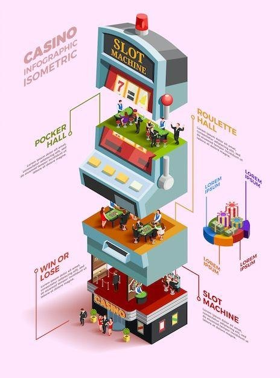

# 赌场空间轴测分解

来源为《第三讲－信息图形类型学》第 38 页。原作标题无法可靠识读时使用描述性案名。图像为课件摘录，原作权利属于相应权利人。

## 01 主数据逻辑

[层级型](../../../01-信息图形数据逻辑/02-层级型信息图形概念定义.md)。按父子、部分与整体或从属层次检索。本图可识读记录以「空间层」及其关系拆解。

## 02 表现标签

[三维型信息图形](../README.md)。立体视图解说空间与部件。

## 特性、视觉编码与叙事

几层等轴测场景上下叠放，彩色引线把赌场元素连接到相应空间。

## 制作方法与流程

1. 建楼层与功能节点表。
2. 选择统一等轴测网格。
3. 在布局和配色后检查层级映射。

## 基础数据与信息结构

[下载基础数据集（CSV）](基础数据集.csv)。本表记录可辨认的条目、关系或图形构件。源表未随课件提供，无法可靠识读的数值待核验。每行记录一项观测，每列存一个字段。

| 空间层 | 图面要素 | 来源页 | 证据类型 |
| --- | --- | --- | --- |
| 顶部 | 机台造型 | 38 | 结构观察 |
| 中部 | 游戏场景 | 38 | 结构观察 |
| 底部 | 建筑入口 | 38 | 结构观察 |
