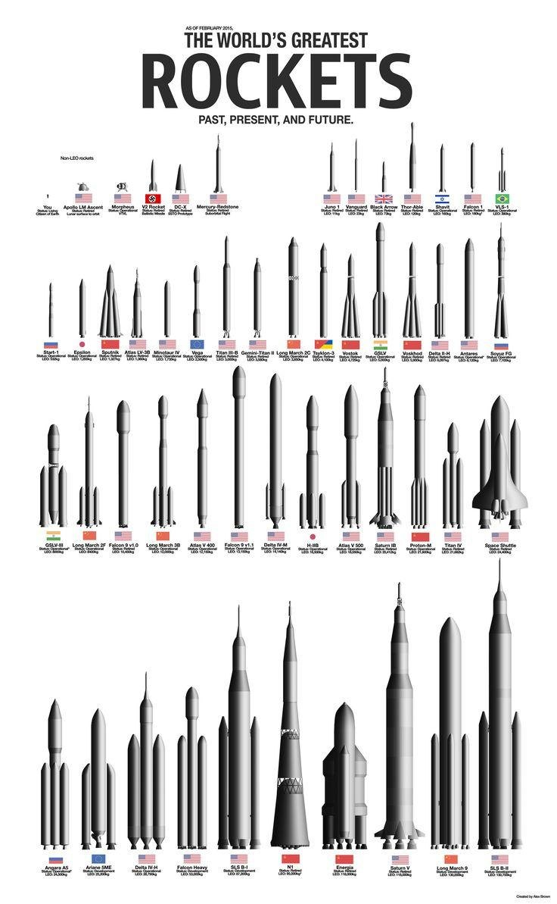

# 世界火箭系列尺寸图

来源为《第三讲－信息图形类型学》第 31 页。原作标题无法可靠识读时使用描述性案名。图像为课件摘录，原作权利属于相应权利人。

## 01 主数据逻辑

[编目型](../../../01-信息图形数据逻辑/03-编目型信息图形概念定义.md)。按主体条目、属性或类别比较。本图可识读记录以「记录对象」及其关系拆解。

## 02 表现标签

[单一图表型信息图形](../README.md)。用一张主要图形支撑读数或评估。

## 特性、视觉编码与叙事

连续列中的火箭剪影呈现外形与体量，分行组织规模，旗帜帮助检索。

## 制作方法与流程

1. 逐型号整理尺寸与版本。
2. 明确行间尺度是否共用。
3. 制作同基线轮廓并补可读标签。

## 基础数据与信息结构

[下载基础数据集（CSV）](基础数据集.csv)。本表记录可辨认的条目、关系或图形构件。源表未随课件提供，无法可靠识读的数值待核验。每行记录一项观测，每列存一个字段。

| 记录对象 | 可见要素 | 来源页 | 证据类型 |
| --- | --- | --- | --- |
| 火箭 | 剪影 | 31 | 结构观察 |
| 火箭 | 标题标签 | 31 | 结构观察 |
| 火箭 | 国别符号 | 31 | 结构观察 |
