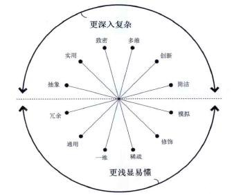

# 信息图形评估轮盘

来源为《第三讲－信息图形类型学》第 45 页。原作标题无法可靠识读时使用描述性案名。图像为课件摘录，原作权利属于相应权利人。

## 01 主数据逻辑

[编目型](../../../01-信息图形数据逻辑/03-编目型信息图形概念定义.md)。按主体条目、属性或类别比较。本图可识读记录以「维度端点A」及其关系拆解。

## 02 表现标签

[单一图表型信息图形](../README.md)。用一张主要图形支撑读数或评估。

## 特性、视觉编码与叙事

轮盘从中心发射维度轴，端点文字提示尺度含义；上下弧线提示读图方向。

## 制作方法与流程

1. 建立维度和两端定义。
2. 均布径向轴。
3. 将端点文字排在外圈。
4. 无评分时保留空白。

## 基础数据与信息结构

[下载基础数据集（CSV）](基础数据集.csv)。本表记录可辨认的条目、关系或图形构件。源表未随课件提供，无法可靠识读的数值待核验。每行记录一项观测，每列存一个字段。

| 维度端点A | 维度端点B | 来源页 | 证据类型 |
| --- | --- | --- | --- |
| 抽象 | 模拟 | 45 | 结构观察 |
| 创新 | 通用 | 45 | 结构观察 |
| 简洁 | 冗余 | 45 | 结构观察 |
| 一维 | 多维 | 45 | 结构观察 |
