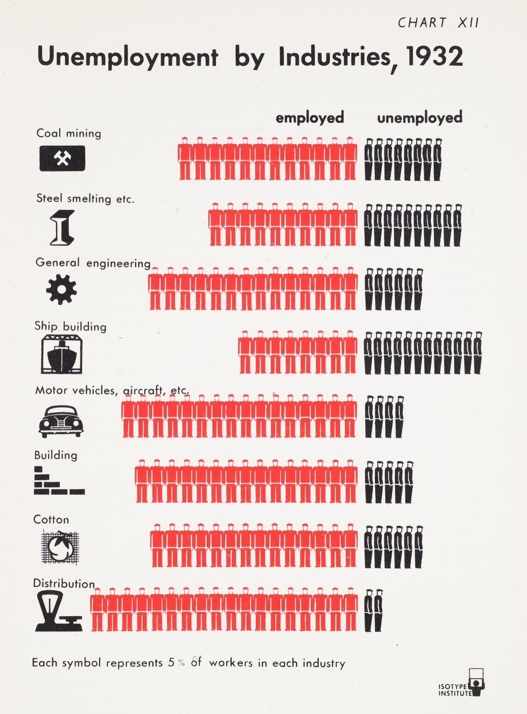

# 1932年分行业失业状况

来源为《第三讲－信息图形类型学》第 59 页。原作标题无法可靠识读时使用描述性案名。图像为课件摘录，原作权利属于相应权利人。

## 01 主数据逻辑

[编目型](../../../01-信息图形数据逻辑/03-编目型信息图形概念定义.md)。按主体条目、属性或类别比较。本图可识读记录以「行业」及其关系拆解。

## 02 表现标签

[单一图表型信息图形](../README.md)。用一张主要图形支撑读数或评估。

设计方法：[ISOTYPE](../../ISOTYPE/README.md)。

## 特性、视觉编码与叙事

同尺寸人形符号并排组成行业比较，颜色区分就业状态。

## 制作方法与流程

1. 先以行业和就业状态建表。
2. 按原图图例设置单个符号代表量。
3. 复核半符号和行总量后排版。

## 基础数据与信息结构

[下载基础数据集（CSV）](基础数据集.csv)。本表记录图面可辨认的数值、时间或索引，空白表示未可靠辨认。每行记录一项观测，每列存一个字段。

| 行业 | 图面分类 | 年份 | 来源页 | 证据类型 |
| --- | --- | --- | --- | --- |
| 煤矿 | 就业与失业分组 | 1932 | 59 | 图面转录 |
| 钢铁冶炼 | 就业与失业分组 | 1932 | 59 | 图面转录 |
| 棉纺 | 就业与失业分组 | 1932 | 59 | 图面转录 |
