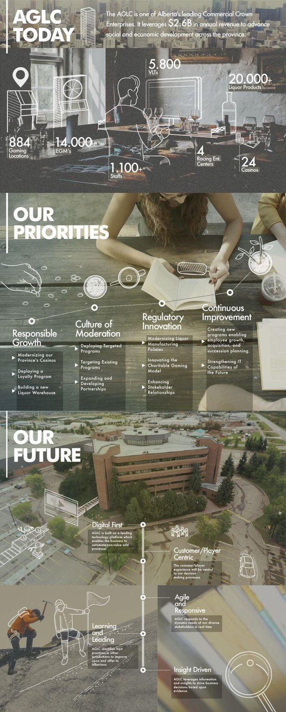

# 机构现况优先事项与未来

来源为《第三讲－信息图形类型学》第 29 页。原作标题无法可靠识读时使用描述性案名。图像为课件摘录，原作权利属于相应权利人。

## 01 主数据逻辑

[编目型](../../../01-信息图形数据逻辑/03-编目型信息图形概念定义.md)。按主体条目、属性或类别比较。本图可识读记录以「模块」及其关系拆解。

## 02 表现标签

[图片式信息图形](../README.md)。照片或插画提供情境证据。

## 特性、视觉编码与叙事

照片分隔三块叙事，白色文字覆盖图像并标出阅读入口。

## 制作方法与流程

1. 把组织主题、事实和照片索引分列。
2. 裁出可放文字区域。
3. 加对比层后检查阅读顺序。

## 基础数据与信息结构

[下载基础数据集（CSV）](基础数据集.csv)。本表记录可辨认的条目、关系或图形构件。源表未随课件提供，无法可靠识读的数值待核验。每行记录一项观测，每列存一个字段。

| 模块 | 图面要素 | 来源页 | 证据类型 |
| --- | --- | --- | --- |
| Today | 背景照片 | 29 | 结构观察 |
| Priorities | 背景照片 | 29 | 结构观察 |
| Future | 背景照片 | 29 | 结构观察 |
