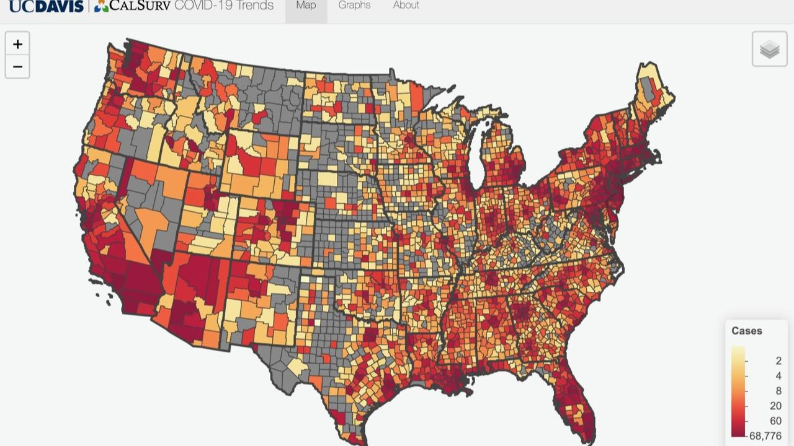

# 美国县级分布地图

来源为《第三讲－信息图形类型学》第 9 页。转录的是图例刻度；截图未提供完整日期及县级原始表。

## 01 主数据逻辑

[地理图形](../../../01-信息图形数据逻辑/05-地理图形信息图形概念定义.md)。通过空间位置、区域或路径查找对象。本图可识读记录以「图例刻度」及其关系拆解。

## 02 表现标签

[地标型信息图形](../README.md)。位置、路径或区域提供主参照。

## 特性、视觉编码与叙事

县界形成面要素，暖色阶传达指标级差，插图右下图例帮助回读。

## 制作方法与流程

1. 以县代码连接统计表与边界数据。
2. 明确指标是总量还是比例。
3. 设定分级阈值并校验缺失色。

## 基础数据与信息结构

[下载基础数据集（CSV）](基础数据集.csv)。本表记录图面可辨认的数值、时间或索引，空白表示未可靠辨认。每行记录一项观测，每列存一个字段。

| 图例刻度 | 单位 | 来源页 | 证据类型 |
| --- | --- | --- | --- |
| 2 | 例 | 9 | 图面转录 |
| 4 | 例 | 9 | 图面转录 |
| 8 | 例 | 9 | 图面转录 |
| 20 | 例 | 9 | 图面转录 |
| 60 | 例 | 9 | 图面转录 |
| 68776 | 例 | 9 | 图面转录 |
