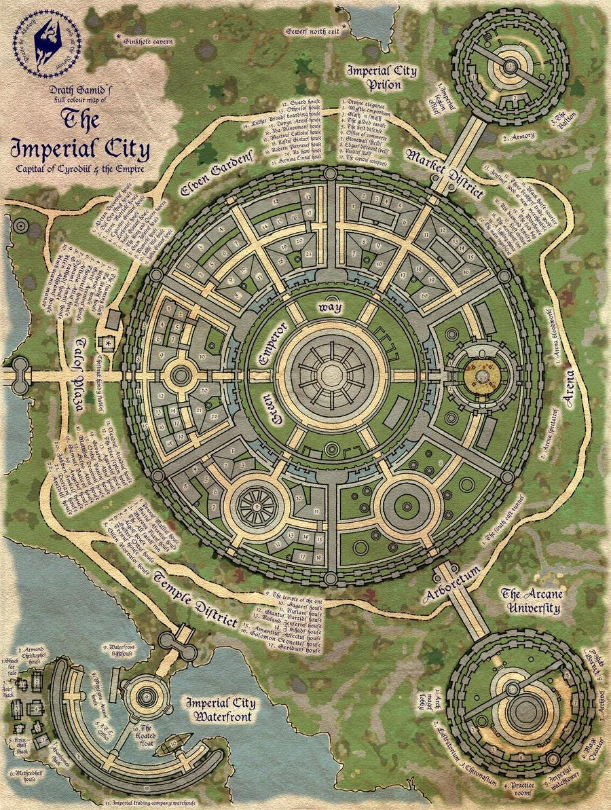

# 帝都环形平面地图

来源为《第三讲－信息图形类型学》第 17 页。原作标题无法可靠识读时使用描述性案名。图像为课件摘录，原作权利属于相应权利人。

## 01 主数据逻辑

[地理图形](../../../01-信息图形数据逻辑/05-地理图形信息图形概念定义.md)。通过空间位置、区域或路径查找对象。本图可识读记录以「地点要素」及其关系拆解。

## 02 表现标签

[地标型信息图形](../README.md)。位置、路径或区域提供主参照。

## 特性、视觉编码与叙事

同心街区和放射道路提供方位，外围地貌提示城内外关系，装饰图框承载标题。

## 制作方法与流程

1. 将道路、功能区和底图分层描绘。
2. 保留方向及图例。
3. 检查地名与区域一一对应。

## 基础数据与信息结构

[下载基础数据集（CSV）](基础数据集.csv)。本表记录可辨认的条目、关系或图形构件。源表未随课件提供，无法可靠识读的数值待核验。每行记录一项观测，每列存一个字段。

| 地点要素 | 图面表达 | 来源页 | 证据类型 |
| --- | --- | --- | --- |
| 中心区 | 同心环 | 17 | 结构观察 |
| 道路 | 放射线 | 17 | 结构观察 |
| 外围地形 | 底图 | 17 | 结构观察 |
