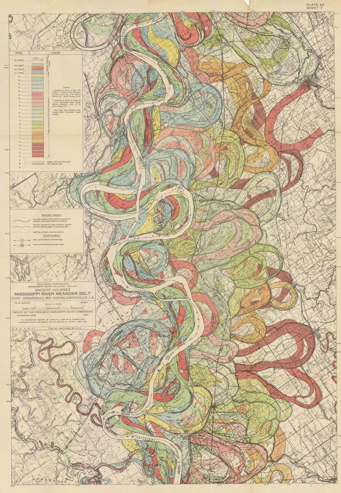

# 河道迁移图上幅

来源为《第三讲－信息图形类型学》第 20 页。原作标题无法可靠识读时使用描述性案名。图像为课件摘录，原作权利属于相应权利人。

## 01 主数据逻辑

[地理图形](../../../01-信息图形数据逻辑/05-地理图形信息图形概念定义.md)。通过空间位置、区域或路径查找对象。本图可识读记录以「记录对象」及其关系拆解。

## 02 表现标签

[地标型信息图形](../README.md)。位置、路径或区域提供主参照。

## 特性、视觉编码与叙事

不同颜色叠画旧河槽，同一底图使读者辨认河道位置如何变化。

## 制作方法与流程

1. 配准不同时期河槽。
2. 建立河槽与时期键。
3. 按年代生成图例并检查覆盖顺序。

## 基础数据与信息结构

[下载基础数据集（CSV）](基础数据集.csv)。本表记录可辨认的条目、关系或图形构件。源表未随课件提供，无法可靠识读的数值待核验。每行记录一项观测，每列存一个字段。

| 记录对象 | 可见要素 | 来源页 | 证据类型 |
| --- | --- | --- | --- |
| 河槽 | 彩色面带 | 20 | 结构观察 |
| 时期 | 颜色 | 20 | 结构观察 |
| 谷地 | 底图 | 20 | 结构观察 |

[对照关联图件](../20-2-河道迁移图下幅/案例分析.md)
