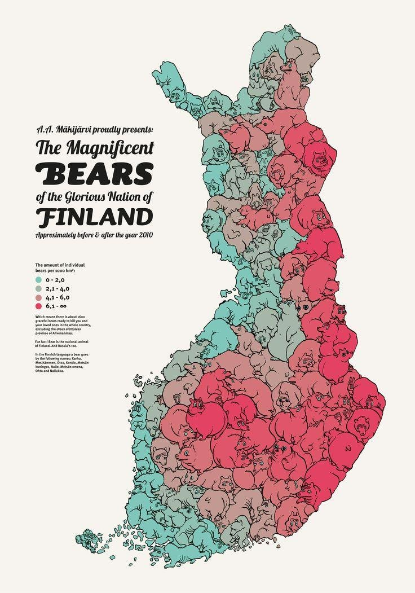

# 芬兰熊地理分布

来源为《第三讲－信息图形类型学》第 30 页。课件将此图放在层级型示例页；本案以行政区为空间索引。

## 01 主数据逻辑

[地理图形](../../../01-信息图形数据逻辑/05-地理图形信息图形概念定义.md)。通过空间位置、区域或路径查找对象。本图可识读记录以「记录对象」及其关系拆解。

## 02 表现标签

[地标型信息图形](../README.md)。位置、路径或区域提供主参照。

## 特性、视觉编码与叙事

地图面色表现地区差异，叠加标记强化局部信息，左侧图例解释变量。

## 制作方法与流程

1. 连接地区统计和行政区。
2. 以图例固定分级。
3. 再为叠加形状单列来源和计量口径。

## 基础数据与信息结构

[下载基础数据集（CSV）](基础数据集.csv)。本表记录可辨认的条目、关系或图形构件。源表未随课件提供，无法可靠识读的数值待核验。每行记录一项观测，每列存一个字段。

| 记录对象 | 可见要素 | 来源页 | 证据类型 |
| --- | --- | --- | --- |
| 地区 | 行政边界 | 30 | 结构观察 |
| 分布指标 | 填色等级 | 30 | 结构观察 |
| 地区补充 | 图形叠加 | 30 | 结构观察 |
