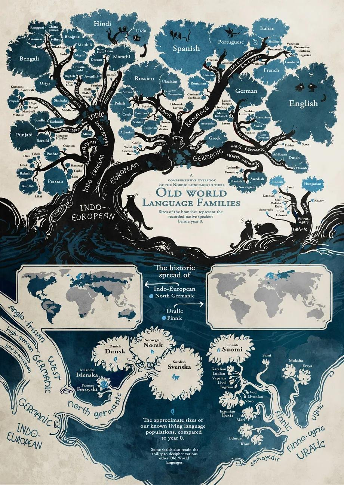

# 旧大陆语言家族树

来源为《第三讲－信息图形类型学》第 1 页。原作标题无法可靠识读时使用描述性案名。图像为课件摘录，原作权利属于相应权利人。

## 01 主数据逻辑

[层级型](../../../01-信息图形数据逻辑/02-层级型信息图形概念定义.md)。按父子、部分与整体或从属层次检索。本图可识读记录以「节点」及其关系拆解。

## 02 表现标签

[层级表现型信息图形](../README.md)。以嵌套、分叉或层叠表达层级。

## 特性、视觉编码与叙事

主干和枝杈表示谱系，顶部叶簇聚合分支，下方地图补充区域分布。

## 制作方法与流程

1. 整理语系与下属语言的父节点关系。
2. 绘制分支。
3. 再把区域示意放在树下并核对树图与地图的标签。

## 基础数据与信息结构

[下载基础数据集（CSV）](基础数据集.csv)。本表记录可辨认的条目、关系或图形构件。源表未随课件提供，无法可靠识读的数值待核验。每行记录一项观测，每列存一个字段。

| 节点 | 父节点 | 来源页 | 证据类型 |
| --- | --- | --- | --- |
| 语言家族树 |  | 1 | 结构观察 |
| 印欧语系 | 语言家族树 | 1 | 结构观察 |
| 乌拉尔语系 | 语言家族树 | 1 | 结构观察 |
