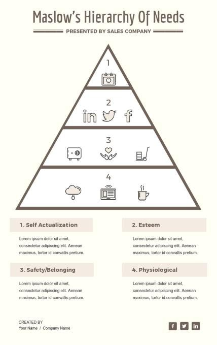

# 马斯洛需求金字塔

来源为《第三讲－信息图形类型学》第 2 页。原作标题无法可靠识读时使用描述性案名。图像为课件摘录，原作权利属于相应权利人。

## 01 主数据逻辑

[层级型](../../../01-信息图形数据逻辑/02-层级型信息图形概念定义.md)。按父子、部分与整体或从属层次检索。本图可识读记录以「层级序号」及其关系拆解。

## 02 表现标签

[层级表现型信息图形](../README.md)。以嵌套、分叉或层叠表达层级。

## 特性、视觉编码与叙事

三角形四个区块通过高度编码层级，图标和底部文字帮助识别和解释。层宽属于构图。

## 制作方法与流程

1. 按原图建立四层节点和图符清单。
2. 核对层名与序号后配置分层形状和文字。

## 基础数据与信息结构

[下载基础数据集（CSV）](基础数据集.csv)。本表记录图面可辨认的数值、时间或索引，空白表示未可靠辨认。每行记录一项观测，每列存一个字段。

| 层级序号 | 层名 | 来源页 | 证据类型 |
| --- | --- | --- | --- |
| 1 | 自我实现 | 2 | 图面转录 |
| 2 | 尊重 | 2 | 图面转录 |
| 3 | 社交与归属 | 2 | 图面转录 |
| 4 | 生理需求 | 2 | 图面转录 |
