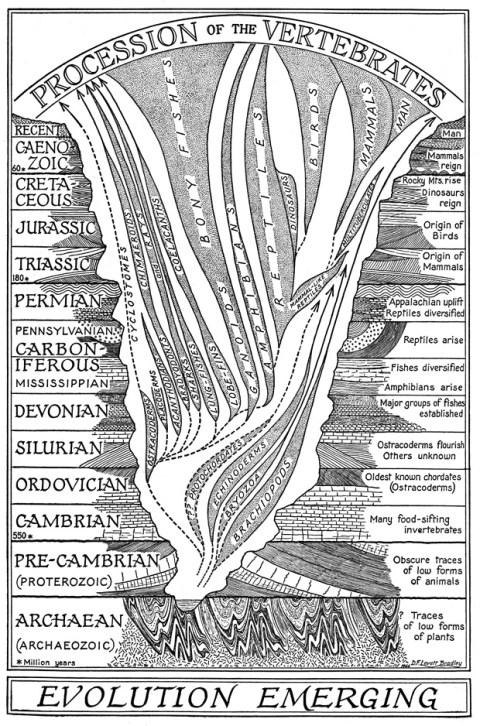

# 脊椎动物演化分支

来源为《第三讲－信息图形类型学》第 6 页。原作标题无法可靠识读时使用描述性案名。图像为课件摘录，原作权利属于相应权利人。

## 01 主数据逻辑

[层级型](../../../01-信息图形数据逻辑/02-层级型信息图形概念定义.md)。按父子、部分与整体或从属层次检索。本图可识读记录以「地质分段」及其关系拆解。

## 02 表现标签

[层级表现型信息图形](../README.md)。以嵌套、分叉或层叠表达层级。

## 特性、视觉编码与叙事

纵向地层标记给分支加时间参照，曲线交叉关系展示演化路径；图面宽度缺少定量口径。

## 制作方法与流程

1. 建地质时期表和分支关系表。
2. 保持上下顺序。
3. 把谱系曲线叠入分段轴并核对地层标签。

## 基础数据与信息结构

[下载基础数据集（CSV）](基础数据集.csv)。本表记录可辨认的条目、关系或图形构件。源表未随课件提供，无法可靠识读的数值待核验。每行记录一项观测，每列存一个字段。

| 地质分段 | 图面结构 | 来源页 | 证据类型 |
| --- | --- | --- | --- |
| 寒武纪 | 分支底段 | 6 | 结构观察 |
| 泥盆纪 | 分支带 | 6 | 结构观察 |
| 侏罗纪 | 分支带 | 6 | 结构观察 |
| 白垩纪 | 分支带 | 6 | 结构观察 |
