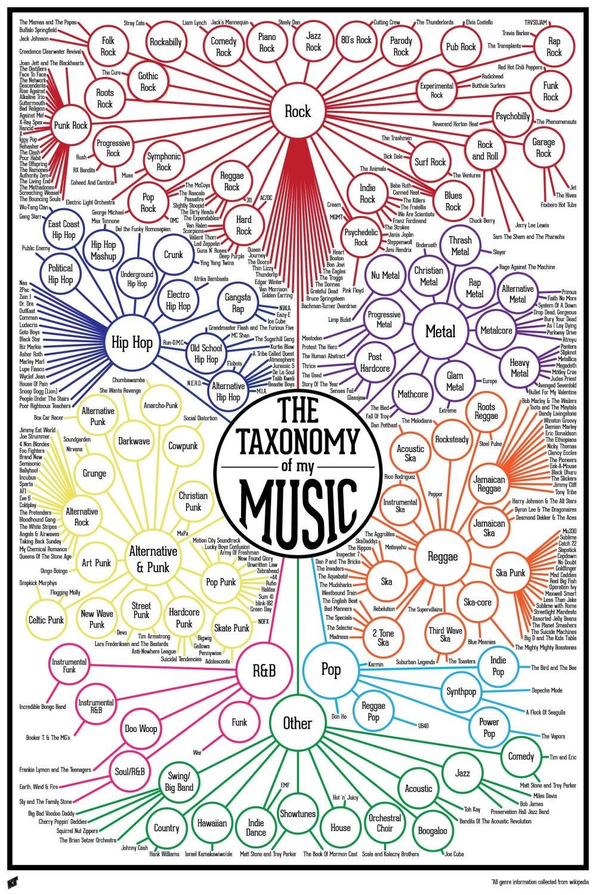

# Taxonomy of Music

来源为《第三讲－信息图形类型学》第 13 页。原作标题无法可靠识读时使用描述性案名。图像为课件摘录，原作权利属于相应权利人。

## 01 主数据逻辑

[层级型](../../../01-信息图形数据逻辑/02-层级型信息图形概念定义.md)。按父子、部分与整体或从属层次检索。本图可识读记录以「记录对象」及其关系拆解。

## 02 表现标签

[层级表现型信息图形](../README.md)。以嵌套、分叉或层叠表达层级。

## 特性、视觉编码与叙事

局部网络以中心及次级节点展开，色彩把不同风格簇区分出来，连线提示归组。

## 制作方法与流程

1. 先整理风格和关联键。
2. 检查多重归类。
3. 再按风格簇绘制与标注关系图。

## 基础数据与信息结构

[下载基础数据集（CSV）](基础数据集.csv)。本表记录可辨认的条目、关系或图形构件。源表未随课件提供，无法可靠识读的数值待核验。每行记录一项观测，每列存一个字段。

| 记录对象 | 可见要素 | 来源页 | 证据类型 |
| --- | --- | --- | --- |
| 音乐分类 | 中心标题 | 13 | 结构观察 |
| 风格组 | 颜色 | 13 | 结构观察 |
| 子类 | 圆节点 | 13 | 结构观察 |
