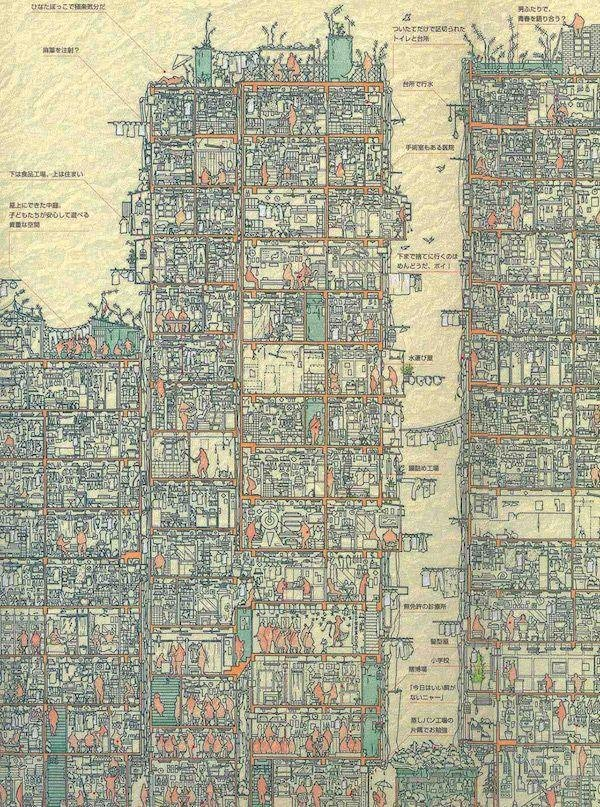

# 手绘建筑剖层图

来源为《第三讲－信息图形类型学》第 35 页。原作标题无法可靠识读时使用描述性案名。图像为课件摘录，原作权利属于相应权利人。

## 01 主数据逻辑

[层级型](../../../01-信息图形数据逻辑/02-层级型信息图形概念定义.md)。按父子、部分与整体或从属层次检索。本图可识读记录以「记录对象」及其关系拆解。

## 02 表现标签

[手稿型信息图形](../README.md)。手绘线稿是主要表达媒介。

## 特性、视觉编码与叙事

房间和楼层以密集格子嵌套，黑线和局部色调帮助逐层扫读。

## 制作方法与流程

1. 先画建筑轮廓与层间关系。
2. 再填内部空间和局部细节。
3. 核对标记与楼层。

## 基础数据与信息结构

[下载基础数据集（CSV）](基础数据集.csv)。本表记录可辨认的条目、关系或图形构件。源表未随课件提供，无法可靠识读的数值待核验。每行记录一项观测，每列存一个字段。

| 记录对象 | 图面要素 | 来源页 | 证据类型 |
| --- | --- | --- | --- |
| 建筑外缘 | 手绘轮廓 | 35 | 结构观察 |
| 层内空间 | 小格 | 35 | 结构观察 |
| 部分位置 | 引线 | 35 | 结构观察 |
