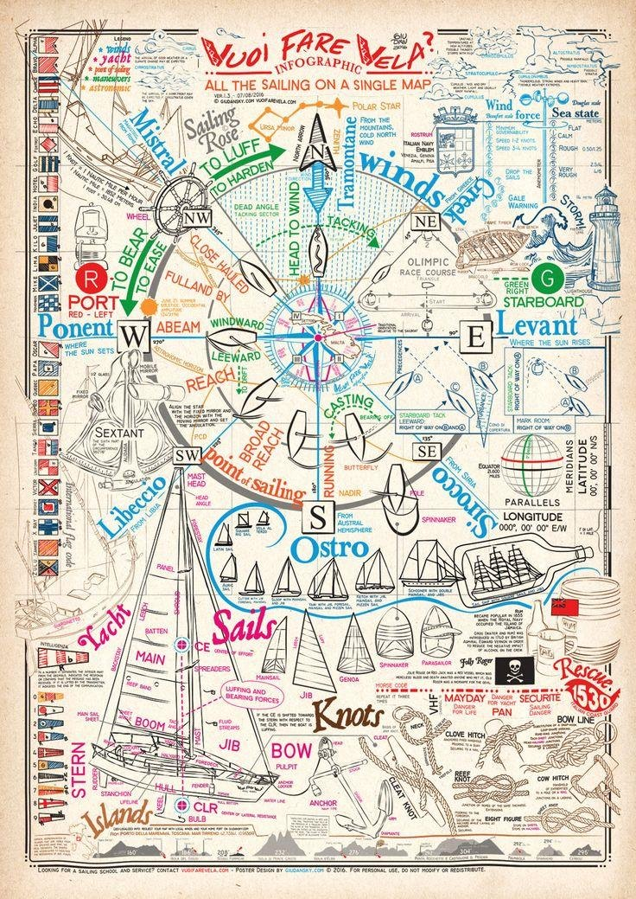

# 手绘城市路线导览

来源为《第三讲－信息图形类型学》第 35 页。原作标题无法可靠识读时使用描述性案名。图像为课件摘录，原作权利属于相应权利人。

## 01 主数据逻辑

[地理图形](../../../01-信息图形数据逻辑/05-地理图形信息图形概念定义.md)。通过空间位置、区域或路径查找对象。本图可识读记录以「记录对象」及其关系拆解。

## 02 表现标签

[手稿型信息图形](../README.md)。手绘线稿是主要表达媒介。

## 特性、视觉编码与叙事

线稿建立空间底图，彩色线和手写地名让路线可跟随。

## 制作方法与流程

1. 建立地点与路线表。
2. 先绘主要空间骨架。
3. 再用色线标路径。
4. 核对地名位置。

## 基础数据与信息结构

[下载基础数据集（CSV）](基础数据集.csv)。本表记录可辨认的条目、关系或图形构件。源表未随课件提供，无法可靠识读的数值待核验。每行记录一项观测，每列存一个字段。

| 记录对象 | 图面要素 | 来源页 | 证据类型 |
| --- | --- | --- | --- |
| 街区 | 线稿 | 35 | 结构观察 |
| 地点 | 手写标签 | 35 | 结构观察 |
| 路线 | 彩色线 | 35 | 结构观察 |
