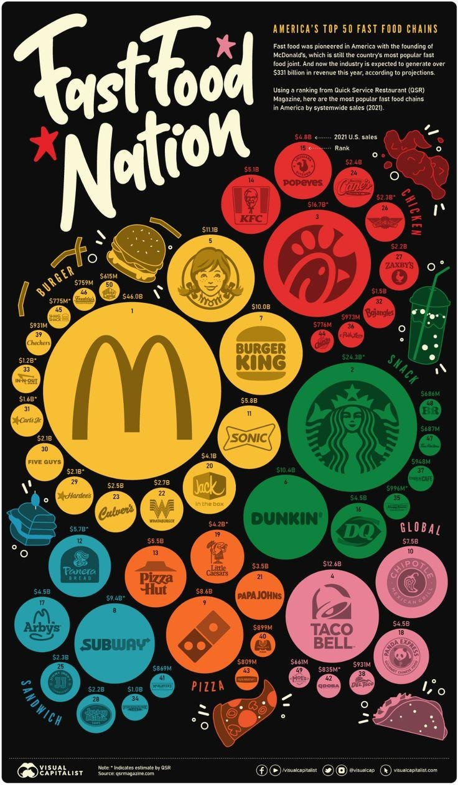

# Fast Food Nation

来源为《第三讲－信息图形类型学》第 32 页。原作标题无法可靠识读时使用描述性案名。图像为课件摘录，原作权利属于相应权利人。

## 01 主数据逻辑

[编目型](../../../01-信息图形数据逻辑/03-编目型信息图形概念定义.md)。按主体条目、属性或类别比较。本图可识读记录以「记录对象」及其关系拆解。

## 02 表现标签

[文字可视化](../README.md)。词语或其形态本身承载视觉结构。

## 特性、视觉编码与叙事

文字标和品牌标识以不同色簇聚合，中心大标志形成跳读入口。

## 制作方法与流程

1. 按品牌及类别拆表。
2. 明确圆尺寸是否有计量意义。
3. 按簇排布后校对标志和图注。

## 基础数据与信息结构

[下载基础数据集（CSV）](基础数据集.csv)。本表记录可辨认的条目、关系或图形构件。源表未随课件提供，无法可靠识读的数值待核验。每行记录一项观测，每列存一个字段。

| 记录对象 | 图面要素 | 来源页 | 证据类型 |
| --- | --- | --- | --- |
| 品牌 | 彩色簇 | 32 | 结构观察 |
| 品牌 | 标志文字 | 32 | 结构观察 |
| 分组项目 | 圆形容器 | 32 | 结构观察 |
