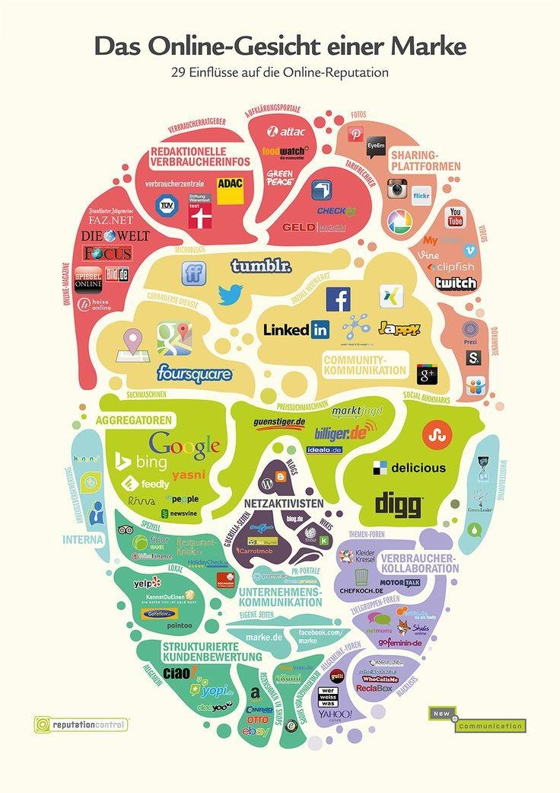

# 品牌的在线面孔

来源为《第三讲－信息图形类型学》第 72 页。原作标题无法可靠识读时使用描述性案名。图像为课件摘录，原作权利属于相应权利人。

## 01 主数据逻辑

[编目型](../../../01-信息图形数据逻辑/03-编目型信息图形概念定义.md)。按主体条目、属性或类别比较。本图可识读记录以「记录对象」及其关系拆解。

## 02 表现标签

[文字可视化](../README.md)。词语或其形态本身承载视觉结构。

## 特性、视觉编码与叙事

平台文字与标志作为识别节点，彩色分区拼成脸形，按类别阅读。

## 制作方法与流程

1. 整理平台、用途及分组。
2. 统一标志尺度。
3. 先画语义分区再贴近放置名称。

## 基础数据与信息结构

[下载基础数据集（CSV）](基础数据集.csv)。本表记录可辨认的条目、关系或图形构件。源表未随课件提供，无法可靠识读的数值待核验。每行记录一项观测，每列存一个字段。

| 记录对象 | 图面要素 | 来源页 | 证据类型 |
| --- | --- | --- | --- |
| 平台 | 名称与标志 | 72 | 结构观察 |
| 平台类群 | 色块 | 72 | 结构观察 |
| 主题形状 | 人脸轮廓 | 72 | 结构观察 |
