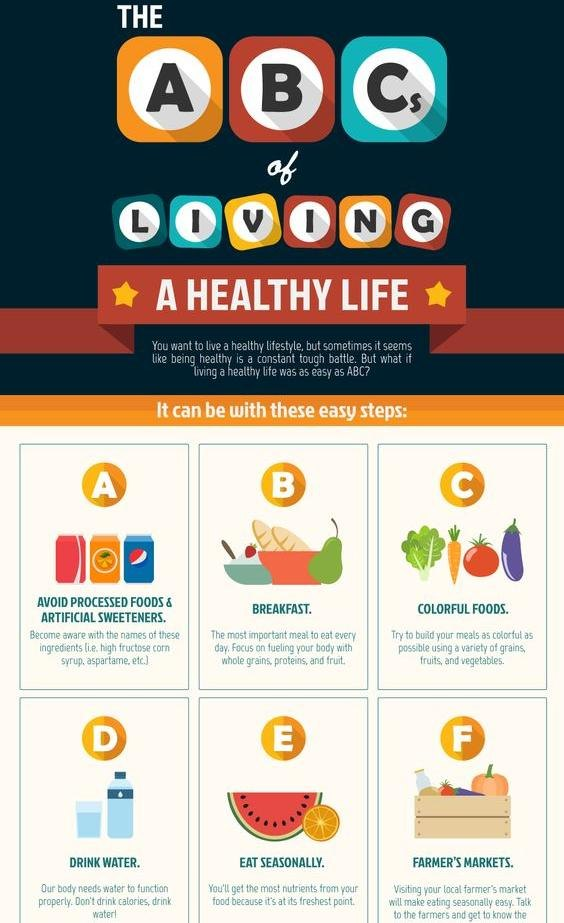

# 健康生活ABC

来源为《第三讲－信息图形类型学》第 2 页。原作标题无法可靠识读时使用描述性案名。图像为课件摘录，原作权利属于相应权利人。

## 01 主数据逻辑

[字母表型](../../../01-信息图形数据逻辑/04-字母表型信息图形概念定义.md)。以字母为固定索引定位条目。本图可识读记录以「索引字母」及其关系拆解。

## 02 表现标签

[文字型与列表型信息图形](../README.md)。主阅读单位是文字层级或条目。

## 特性、视觉编码与叙事

字母置于卡片顶部，图标把饮食或生活建议具体化，读者依字母顺序浏览。

## 制作方法与流程

1. 分别保存字母、建议和图标。
2. 按索引排序。
3. 使用一致卡片样式排版。

## 基础数据与信息结构

[下载基础数据集（CSV）](基础数据集.csv)。本表记录可辨认的条目、关系或图形构件。源表未随课件提供，无法可靠识读的数值待核验。每行记录一项观测，每列存一个字段。

| 索引字母 | 提示 | 来源页 | 证据类型 |
| --- | --- | --- | --- |
| A | 药品图符 | 2 | 结构观察 |
| B | 早餐 | 2 | 结构观察 |
| C | 多样化食物 | 2 | 结构观察 |
| D | 喝水 | 2 | 结构观察 |
| E | 水果 | 2 | 结构观察 |
| F | 家庭用餐 | 2 | 结构观察 |
