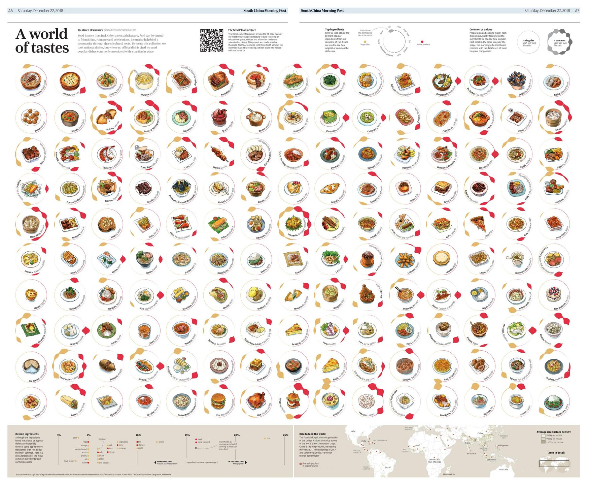

# A World of Tastes

来源为《第三讲－信息图形类型学》第 16 页。原作标题无法可靠识读时使用描述性案名。图像为课件摘录，原作权利属于相应权利人。

## 01 主数据逻辑

[编目型](../../../01-信息图形数据逻辑/03-编目型信息图形概念定义.md)。按主体条目、属性或类别比较。本图可识读记录以「记录对象」及其关系拆解。

## 02 表现标签

[文字型与列表型信息图形](../README.md)。主阅读单位是文字层级或条目。

## 特性、视觉编码与叙事

重复的小圆图以网格排列，菜品图让读者先扫图再读标签，地图提供补充定位。

## 制作方法与流程

1. 为每道菜设唯一键。
2. 分列名称、所属地和图标。
3. 生成网格并把地理字段连到底部地图。

## 基础数据与信息结构

[下载基础数据集（CSV）](基础数据集.csv)。本表记录可辨认的条目、关系或图形构件。源表未随课件提供，无法可靠识读的数值待核验。每行记录一项观测，每列存一个字段。

| 记录对象 | 可见要素 | 来源页 | 证据类型 |
| --- | --- | --- | --- |
| 菜品 | 圆形插图 | 16 | 结构观察 |
| 菜品 | 文字标签 | 16 | 结构观察 |
| 地理背景 | 底部地图 | 16 | 结构观察 |
