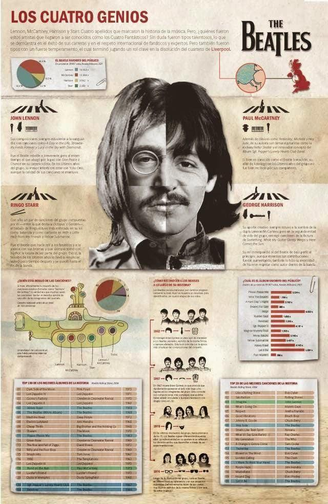

# 披头士四人

来源为用户提供的《第三讲－信息图形类型学》第 23 页。图片提取自课件，图中署名随图保留。

## 案例分析

以四位成员为并列条目，主数据逻辑为编目型。中央合成肖像建立全组印象，周边成员标题与说明便于定位，下方表格和小图补充比较。以上方主题与肖像开篇，再查看各成员的文字和下部细节。课件将其归为文字型／列表型，统计小图属于辅助表达。

[所属标签](../README.md) · [相关数据逻辑](../../../01-信息图形数据逻辑/03-编目型信息图形概念定义.md)
