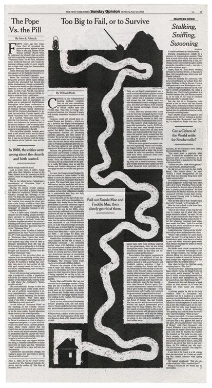

# 纽约时报文字版面

来源为用户提供的《第三讲－信息图形类型学》第 23 页。图片提取自课件，图中署名随图保留。

## 案例分析

以标题、正文分栏和段落构成主要信息层级。黑底与白色蜿蜒图形形成视觉重心，并把连续正文分隔为多个阅读区。先识别标题，再进入对应段落。这里是文字型样本，图面中的主插图未见可读的数值刻度。

[所属标签](../README.md) · [相关数据逻辑](../../../01-信息图形数据逻辑/02-层级型信息图形概念定义.md)
