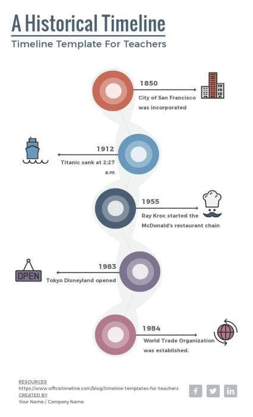

# 五个历史节点

来源为《第三讲－信息图形类型学》第 2 页。1984 年的 WTO 标签按图转录，日期待事实核对。

## 01 主数据逻辑

[编年型](../../../01-信息图形数据逻辑/01-编年型信息图形概念定义.md)。顺序、时期或步骤是主索引。本图可识读记录以「年份」及其关系拆解。

## 02 表现标签

[时间轴型信息图形](../README.md)。用时间参照路径安排事件。

## 特性、视觉编码与叙事

彩色圆环构成纵向阅读轴，左右交错的图标提示事件主题；等距版式传达先后。

## 制作方法与流程

1. 按日期排序。
2. 将年份、事件和图标 ID 分列；交错排列描述并标注等距为版式。

## 基础数据与信息结构

[下载基础数据集（CSV）](基础数据集.csv)。本表记录图面可辨认的数值、时间或索引，空白表示未可靠辨认。每行记录一项观测，每列存一个字段。

| 年份 | 事件 | 来源页 | 证据类型 |
| --- | --- | --- | --- |
| 1850 | 旧金山建制 | 2 | 图面转录 |
| 1912 | 泰坦尼克号沉没 | 2 | 图面转录 |
| 1955 | Ray Kroc开启麦当劳餐厅连锁 | 2 | 图面转录 |
| 1983 | 东京迪士尼乐园开放 | 2 | 图面转录 |
| 1984 | 课件标为世界贸易组织成立 | 2 | 图面转录 |
