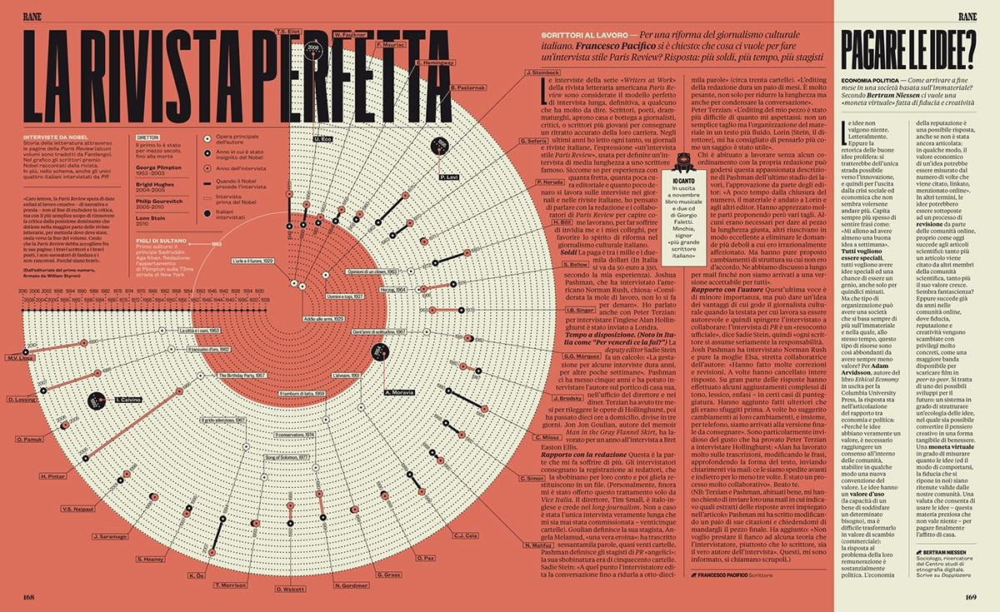

# La Rivista Perfetta环形纪事

来源为《第三讲－信息图形类型学》第 4 页。课件署名 Francesco Muzzi。

## 01 主数据逻辑

[编年型](../../../01-信息图形数据逻辑/01-编年型信息图形概念定义.md)。顺序、时期或步骤是主索引。本图可识读记录以「记录对象」及其关系拆解。

## 02 表现标签

[时间轴型信息图形](../README.md)。用时间参照路径安排事件。

## 特性、视觉编码与叙事

橙色版面将环形主图与正文结合，放射形短线把各事件锚定在轨道上。

## 制作方法与流程

1. 把日期、事件与注释分列。
2. 按时序铺入环形轨道。
3. 再处理密集标签和正文栏。

## 基础数据与信息结构

[下载基础数据集（CSV）](基础数据集.csv)。本表记录可辨认的条目、关系或图形构件。源表未随课件提供，无法可靠识读的数值待核验。每行记录一项观测，每列存一个字段。

| 记录对象 | 可见要素 | 来源页 | 证据类型 |
| --- | --- | --- | --- |
| 时间段 | 环形轨道 | 4 | 结构观察 |
| 事件 | 放射引线 | 4 | 结构观察 |
| 正文 | 多栏文字 | 4 | 结构观察 |
