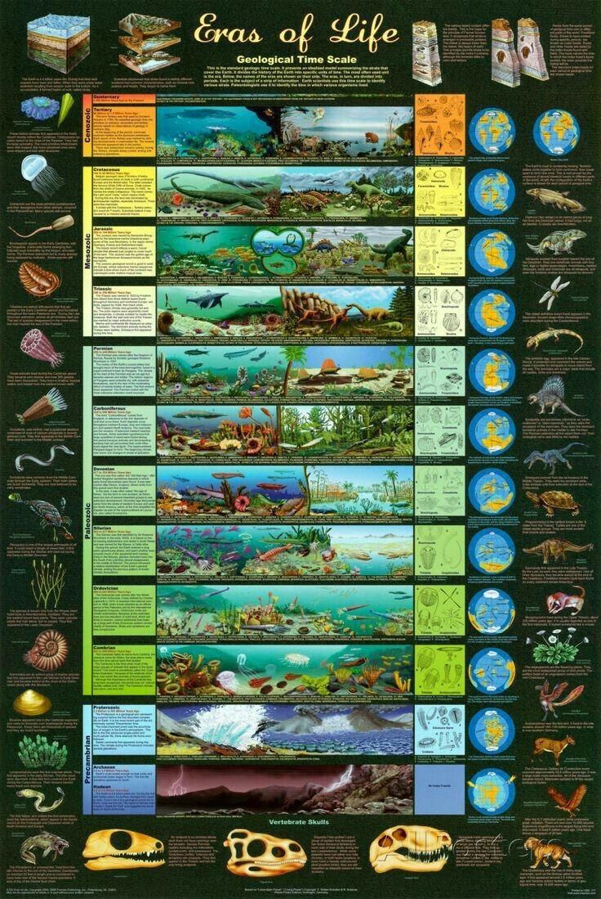

# Eras of Life

来源为《第三讲－信息图形类型学》第 7 页。原作标题无法可靠识读时使用描述性案名。图像为课件摘录，原作权利属于相应权利人。

## 01 主数据逻辑

[编年型](../../../01-信息图形数据逻辑/01-编年型信息图形概念定义.md)。顺序、时期或步骤是主索引。本图可识读记录以「记录对象」及其关系拆解。

## 02 表现标签

[时间轴型信息图形](../README.md)。用时间参照路径安排事件。

## 特性、视觉编码与叙事

中央分期条带展示场景，旁侧地球和化石图把同一时期的其他信息对齐。

## 制作方法与流程

1. 先建立时期表和三类关联记录。
2. 逐时期对齐场景、地球图与化石。
3. 校验上下顺序。

## 基础数据与信息结构

[下载基础数据集（CSV）](基础数据集.csv)。本表记录可辨认的条目、关系或图形构件。源表未随课件提供，无法可靠识读的数值待核验。每行记录一项观测，每列存一个字段。

| 记录对象 | 可见要素 | 来源页 | 证据类型 |
| --- | --- | --- | --- |
| 时期 | 横向带 | 7 | 结构观察 |
| 生物 | 边栏图像 | 7 | 结构观察 |
| 地球 | 圆形示意 | 7 | 结构观察 |
