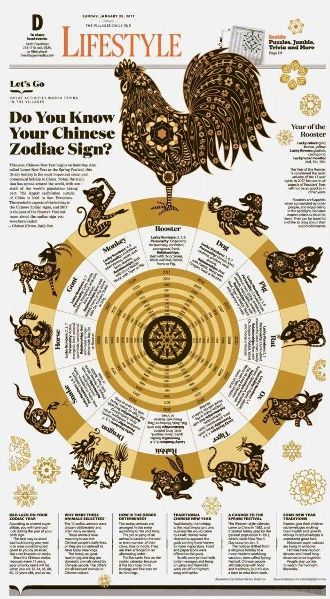

# 十二生肖循环索引

来源为《第三讲－信息图形类型学》第 15 页。原作标题无法可靠识读时使用描述性案名。图像为课件摘录，原作权利属于相应权利人。

## 01 主数据逻辑

[编年型](../../../01-信息图形数据逻辑/01-编年型信息图形概念定义.md)。顺序、时期或步骤是主索引。本图可识读记录以「记录对象」及其关系拆解。

## 02 表现标签

[时间轴型信息图形](../README.md)。用时间参照路径安排事件。

## 特性、视觉编码与叙事

动物图符环绕中心，径向编排显示周期相邻，正文解释如何按年份定位。

## 制作方法与流程

1. 建立生肖顺序、年份及周期表。
2. 把重复周期映射到环形分区。
3. 并核对跨年规则。

## 基础数据与信息结构

[下载基础数据集（CSV）](基础数据集.csv)。本表记录可辨认的条目、关系或图形构件。源表未随课件提供，无法可靠识读的数值待核验。每行记录一项观测，每列存一个字段。

| 记录对象 | 可见要素 | 来源页 | 证据类型 |
| --- | --- | --- | --- |
| 生肖 | 动物图符 | 15 | 结构观察 |
| 循环位置 | 环形分段 | 15 | 结构观察 |
| 年份信息 | 文字 | 15 | 结构观察 |
