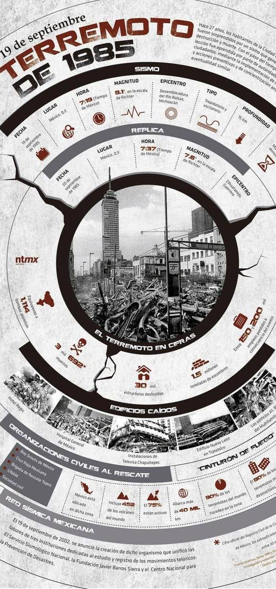

# 1985年地震纪事

来源为《第三讲－信息图形类型学》第 39 页。原作标题无法可靠识读时使用描述性案名。图像为课件摘录，原作权利属于相应权利人。

## 01 主数据逻辑

[编年型](../../../01-信息图形数据逻辑/01-编年型信息图形概念定义.md)。顺序、时期或步骤是主索引。本图可识读记录以「主题」及其关系拆解。

## 02 表现标签

[时间轴型信息图形](../README.md)。用时间参照路径安排事件。

## 特性、视觉编码与叙事

中央震后照片是入口，外环以分区、日期和图标组织事件材料。

## 制作方法与流程

1. 逐项录入日期和图注。
2. 按阶段绘成环带。
3. 再用同心位置挂接细节和照片。

## 基础数据与信息结构

[下载基础数据集（CSV）](基础数据集.csv)。本表记录图面可辨认的数值、时间或索引，空白表示未可靠辨认。每行记录一项观测，每列存一个字段。

| 主题 | 年份 | 图面载体 | 来源页 | 证据类型 |
| --- | --- | --- | --- | --- |
| 地震 | 1985 | 中央照片 | 39 | 图面转录 |
| 时间阶段 |  | 环带说明 | 39 | 图面转录 |
| 事件细节 |  | 图标 | 39 | 图面转录 |
