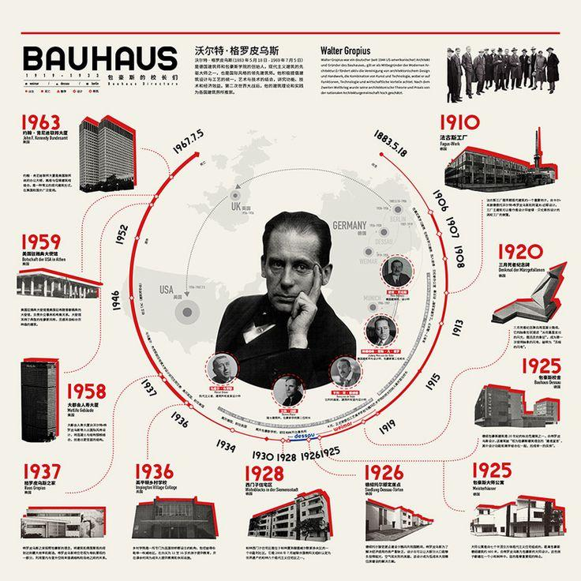

# 包豪斯与格罗皮乌斯

来源为《第三讲－信息图形类型学》第 24 页。原作标题无法可靠识读时使用描述性案名。图像为课件摘录，原作权利属于相应权利人。

## 01 主数据逻辑

[编年型](../../../01-信息图形数据逻辑/01-编年型信息图形概念定义.md)。顺序、时期或步骤是主索引。本图可识读记录以「记录类别」及其关系拆解。

## 02 表现标签

[时间轴型信息图形](../README.md)。用时间参照路径安排事件。

## 特性、视觉编码与叙事

红色年份和建筑图围绕中心肖像；引线把外围实例接到时间带。

## 制作方法与流程

1. 分别建立项目、人物和时间节点。
2. 核对每个建筑节点的年份。
3. 引线定位后标明时间间距是否按比例。

## 基础数据与信息结构

[下载基础数据集（CSV）](基础数据集.csv)。本表记录图面可辨认的数值、时间或索引，空白表示未可靠辨认。每行记录一项观测，每列存一个字段。

| 记录类别 | 年份 | 来源页 | 证据类型 |
| --- | --- | --- | --- |
| 外围节点 | 1910 | 24 | 图面转录 |
| 外围节点 | 1920 | 24 | 图面转录 |
| 外围节点 | 1925 | 24 | 图面转录 |
| 外围节点 | 1926 | 24 | 图面转录 |
| 外围节点 | 1928 | 24 | 图面转录 |
| 外围节点 | 1936 | 24 | 图面转录 |
| 外围节点 | 1937 | 24 | 图面转录 |
| 外围节点 | 1958 | 24 | 图面转录 |
| 外围节点 | 1959 | 24 | 图面转录 |
| 外围节点 | 1963 | 24 | 图面转录 |
