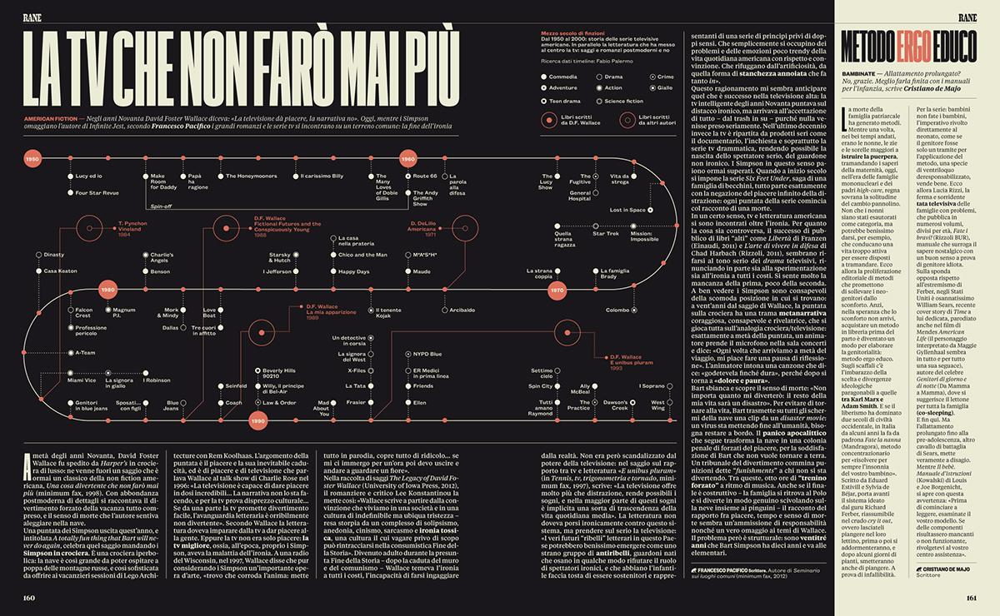

# 电视节目年代轴

来源为用户提供的《第三讲－信息图形类型学》第 5 页。图片提取自课件，图中署名随图保留。

## 案例分析

以年代组织电视节目及旁注，主数据逻辑为编年型。跨行折返的轴线串联年代节点，节目名称用细引线挂在对应位置，圆点样式区分类别。先沿大号年代节点确认方向，再比较同一时期的节目及注释。图面较密，读图时应随轴线折返。

[所属标签](../README.md) · [相关数据逻辑](../../../01-信息图形数据逻辑/01-编年型信息图形概念定义.md)
