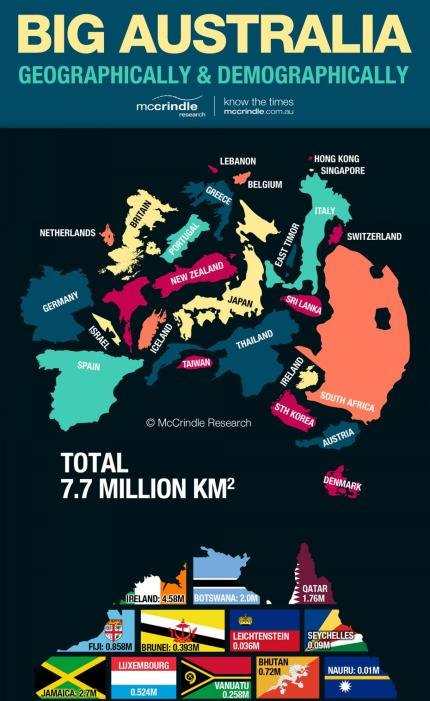

# 澳大利亚面积参照

来源为《第三讲－信息图形类型学》第 2 页。原作标题无法可靠识读时使用描述性案名。图像为课件摘录，原作权利属于相应权利人。

## 01 主数据逻辑

[地理图形](../../../01-信息图形数据逻辑/05-地理图形信息图形概念定义.md)。通过空间位置、区域或路径查找对象。本图可识读记录以「对象」及其关系拆解。

## 02 表现标签

[比较型信息图形](../README.md)。同尺度或并置呈现支撑对照。

## 特性、视觉编码与叙事

地图轮廓和对比色解释面积量级，醒目总面积位于地图下方，底部提供旗帜辅助识别。

## 制作方法与流程

1. 统一面积单位。
2. 按等面积规则确定轮廓缩放。
3. 再核对地名、位置和图例。

## 基础数据与信息结构

[下载基础数据集（CSV）](基础数据集.csv)。本表记录图面可辨认的数值、时间或索引，空白表示未可靠辨认。每行记录一项观测，每列存一个字段。

| 对象 | 指标 | 数值 | 单位 | 来源页 | 证据类型 |
| --- | --- | --- | --- | --- | --- |
| 澳大利亚 | 面积 | 7.7 | 百万平方公里 | 2 | 图面转录 |
| 澳大利亚 | 图形要素 |  |  | 2 | 图面转录 |
| 参照国家 | 图形要素 |  |  | 2 | 图面转录 |
