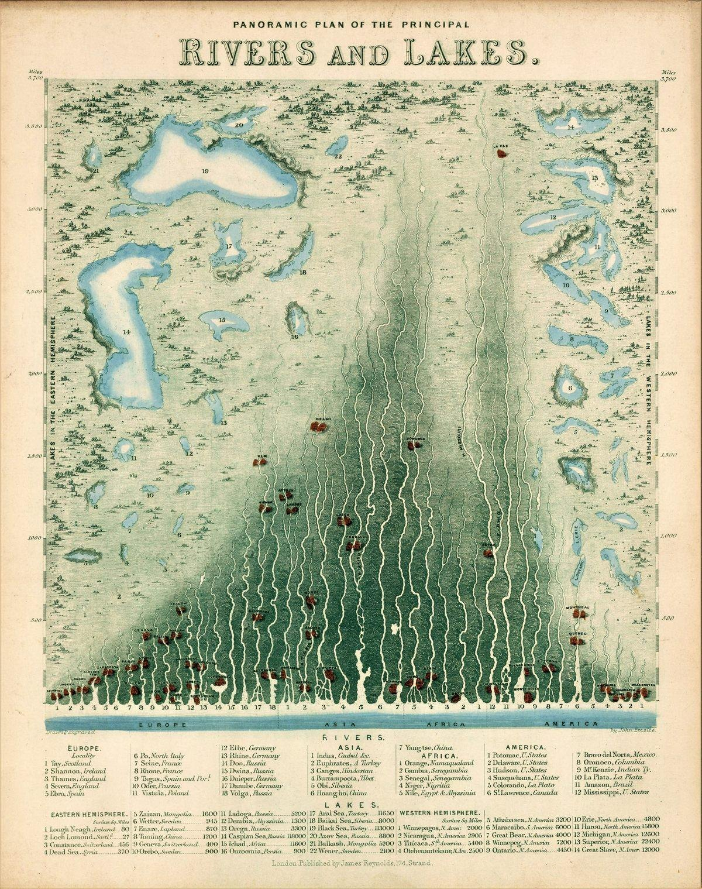

# Rivers and Lakes

来源为《第三讲－信息图形类型学》第 18 页。原作标题无法可靠识读时使用描述性案名。图像为课件摘录，原作权利属于相应权利人。

## 01 主数据逻辑

[地理图形](../../../01-信息图形数据逻辑/05-地理图形信息图形概念定义.md)。通过空间位置、区域或路径查找对象。本图可识读记录以「记录对象」及其关系拆解。

## 02 表现标签

[比较型信息图形](../README.md)。同尺度或并置呈现支撑对照。

## 特性、视觉编码与叙事

中央河流与周边湖泊形成两类比较区，水体形态和编号帮助检索。

## 制作方法与流程

1. 分表记录河长与湖面积。
2. 分别建立尺度。
3. 绘制轮廓并检查编号与底部索引对应。

## 基础数据与信息结构

[下载基础数据集（CSV）](基础数据集.csv)。本表记录可辨认的条目、关系或图形构件。源表未随课件提供，无法可靠识读的数值待核验。每行记录一项观测，每列存一个字段。

| 记录对象 | 可见要素 | 来源页 | 证据类型 |
| --- | --- | --- | --- |
| 河流 | 线状轮廓 | 18 | 结构观察 |
| 湖泊 | 面积轮廓 | 18 | 结构观察 |
| 水体 | 索引号 | 18 | 结构观察 |
