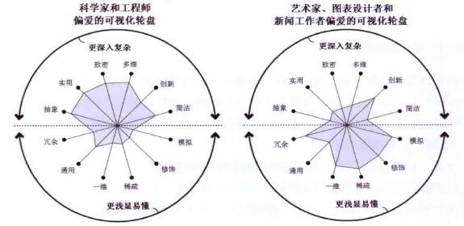

# 两类创作者评估轮盘

来源为《第三讲－信息图形类型学》第 46 页。原作标题无法可靠识读时使用描述性案名。图像为课件摘录，原作权利属于相应权利人。

## 01 主数据逻辑

[编目型](../../../01-信息图形数据逻辑/03-编目型信息图形概念定义.md)。按主体条目、属性或类别比较。本图可识读记录以「比较对象」及其关系拆解。

## 02 表现标签

[比较型信息图形](../README.md)。同尺度或并置呈现支撑对照。

## 特性、视觉编码与叙事

并排雷达以相同维度观察轮廓形状，填色帮助识别整体差异。

## 制作方法与流程

1. 先核对两组轴顺序及评分标尺。
2. 再画同尺度多边形。
3. 保留评价定义。

## 基础数据与信息结构

[下载基础数据集（CSV）](基础数据集.csv)。本表记录可辨认的条目、关系或图形构件。源表未随课件提供，无法可靠识读的数值待核验。每行记录一项观测，每列存一个字段。

| 比较对象 | 图面要素 | 来源页 | 证据类型 |
| --- | --- | --- | --- |
| 科学家与工程师 | 左轮盘 | 46 | 结构观察 |
| 艺术与设计相关创作者 | 右轮盘 | 46 | 结构观察 |
| 维度 | 雷达轴 | 46 | 结构观察 |
