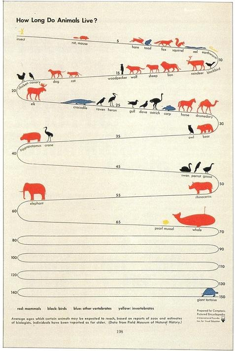

# 动物能活多久

来源为《第三讲－信息图形类型学》第 50 页。原作标题无法可靠识读时使用描述性案名。图像为课件摘录，原作权利属于相应权利人。

## 01 主数据逻辑

[编目型](../../../01-信息图形数据逻辑/03-编目型信息图形概念定义.md)。按主体条目、属性或类别比较。本图可识读记录以「记录对象」及其关系拆解。

## 02 表现标签

[比较型信息图形](../README.md)。同尺度或并置呈现支撑对照。

## 特性、视觉编码与叙事

折返刻度节约空间，动物剪影贴近位置标记，沿同一路径比较寿命。

## 制作方法与流程

1. 确定寿命使用平均还是上限。
2. 记录物种与年数。
3. 在统一时间尺度上折返布局。

## 基础数据与信息结构

[下载基础数据集（CSV）](基础数据集.csv)。本表记录可辨认的条目、关系或图形构件。源表未随课件提供，无法可靠识读的数值待核验。每行记录一项观测，每列存一个字段。

| 记录对象 | 图面要素 | 来源页 | 证据类型 |
| --- | --- | --- | --- |
| 动物 | 剪影 | 50 | 结构观察 |
| 寿命 | 相对位置 | 50 | 结构观察 |
| 尺度 | 折返轨道 | 50 | 结构观察 |
