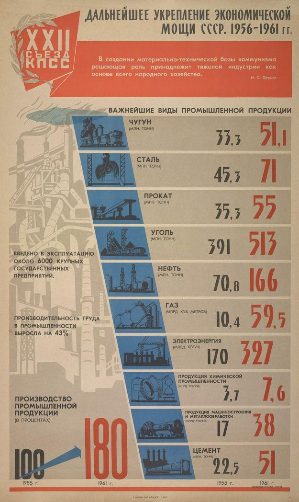

# 苏联经济指标对照海报

来源为《第三讲－信息图形类型学》第 53 页。原作标题无法可靠识读时使用描述性案名。图像为课件摘录，原作权利属于相应权利人。

## 01 主数据逻辑

[编目型](../../../01-信息图形数据逻辑/03-编目型信息图形概念定义.md)。按主体条目、属性或类别比较。本图可识读记录以「记录对象」及其关系拆解。

## 02 表现标签

[比较型信息图形](../README.md)。同尺度或并置呈现支撑对照。

## 特性、视觉编码与叙事

重复行将行业图符和成对数字对齐，红蓝色区分文字重点。

## 制作方法与流程

1. 记录行业、时间、值和单位。
2. 用成对列保证每行口径一致。
3. 注明历史图的统计范围。

## 基础数据与信息结构

[下载基础数据集（CSV）](基础数据集.csv)。本表记录可辨认的条目、关系或图形构件。源表未随课件提供，无法可靠识读的数值待核验。每行记录一项观测，每列存一个字段。

| 记录对象 | 图面要素 | 来源页 | 证据类型 |
| --- | --- | --- | --- |
| 行业 | 图标 | 53 | 结构观察 |
| 指标前值 | 左列数 | 53 | 结构观察 |
| 指标后值 | 右列数 | 53 | 结构观察 |
