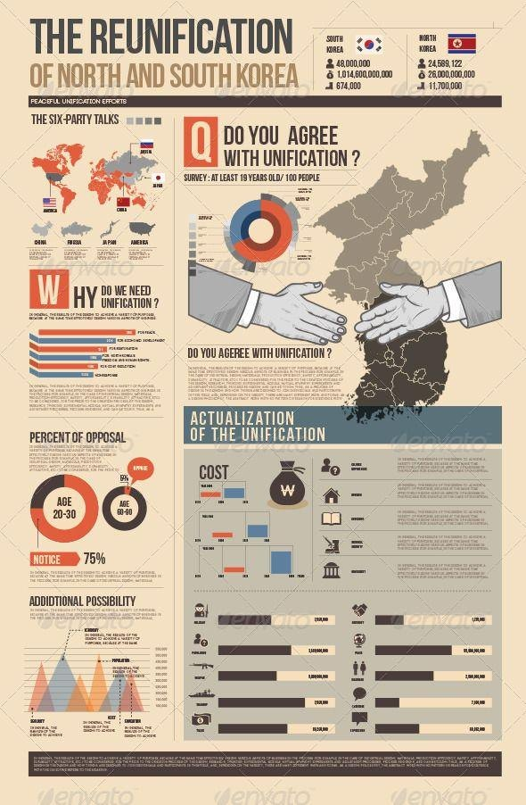

# 朝鲜半岛统一议题比较

来源为《第三讲－信息图形类型学》第 65 页。原作标题无法可靠识读时使用描述性案名。图像为课件摘录，原作权利属于相应权利人。

## 01 主数据逻辑

[编目型](../../../01-信息图形数据逻辑/03-编目型信息图形概念定义.md)。按主体条目、属性或类别比较。本图可识读记录以「模块」及其关系拆解。

## 02 表现标签

[比较型信息图形](../README.md)。同尺度或并置呈现支撑对照。

## 特性、视觉编码与叙事

主标题引导主题，圆形和横条承担比较，中央地图连接区域语境。

## 制作方法与流程

1. 分别建立调查、经济和地理口径。
2. 先绘分组统计。
3. 再加地图说明与阅读顺序。

## 基础数据与信息结构

[下载基础数据集（CSV）](基础数据集.csv)。本表记录可辨认的条目、关系或图形构件。源表未随课件提供，无法可靠识读的数值待核验。每行记录一项观测，每列存一个字段。

| 模块 | 图面要素 | 来源页 | 证据类型 |
| --- | --- | --- | --- |
| 统一态度 | 圆形统计 | 65 | 结构观察 |
| 经济对比 | 横条 | 65 | 结构观察 |
| 地理背景 | 半岛示意 | 65 | 结构观察 |
