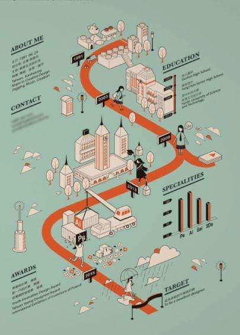

# 等轴测路径流程

来源为《第三讲－信息图形类型学》第 26 页。原作标题无法可靠识读时使用描述性案名。图像为课件摘录，原作权利属于相应权利人。

## 01 主数据逻辑

[编年型](../../../01-信息图形数据逻辑/01-编年型信息图形概念定义.md)。顺序、时期或步骤是主索引。本图可识读记录以「记录对象」及其关系拆解。

## 02 表现标签

[流程图型](../README.md)。用步骤及其转移关系引导阅读。

## 特性、视觉编码与叙事

红色曲线串联等轴测场景，环境造型提供步骤地标，小柱图补充一类统计维度。

## 制作方法与流程

1. 先列阶段与依赖。
2. 再布置红色主路径。
3. 叠加场景。
4. 补充图表并核对其轴与标签。

## 基础数据与信息结构

[下载基础数据集（CSV）](基础数据集.csv)。本表记录可辨认的条目、关系或图形构件。源表未随课件提供，无法可靠识读的数值待核验。每行记录一项观测，每列存一个字段。

| 记录对象 | 可见要素 | 来源页 | 证据类型 |
| --- | --- | --- | --- |
| 流程阶段 | 建筑场景 | 26 | 结构观察 |
| 路线 | 红色带 | 26 | 结构观察 |
| 统计补充 | 柱形图 | 26 | 结构观察 |
