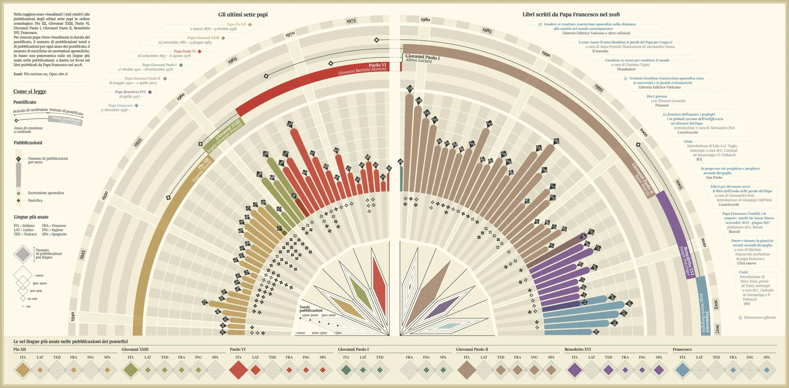

# 半环分类比较图

来源为《第三讲－信息图形类型学》第 12 页。原作标题无法可靠识读时使用描述性案名。图像为课件摘录，原作权利属于相应权利人。

## 01 主数据逻辑

[编目型](../../../01-信息图形数据逻辑/03-编目型信息图形概念定义.md)。按主体条目、属性或类别比较。本图可识读记录以「记录对象」及其关系拆解。

## 02 表现标签

[混合型信息图形](../README.md)。统计图、符号和说明合作承载内容。

## 特性、视觉编码与叙事

扇形位置区分类别，径向条使数值沿同心刻度伸展，图底摘要支撑检索。

## 制作方法与流程

1. 按类别与指标拆表。
2. 确认径向长度起点和尺度。
3. 生成扇区与图例后检查外侧标签密度。

## 基础数据与信息结构

[下载基础数据集（CSV）](基础数据集.csv)。本表记录可辨认的条目、关系或图形构件。源表未随课件提供，无法可靠识读的数值待核验。每行记录一项观测，每列存一个字段。

| 记录对象 | 可见要素 | 来源页 | 证据类型 |
| --- | --- | --- | --- |
| 类别 | 分区 | 12 | 结构观察 |
| 指标 | 径向条 | 12 | 结构观察 |
| 辅助信息 | 外环文字 | 12 | 结构观察 |
