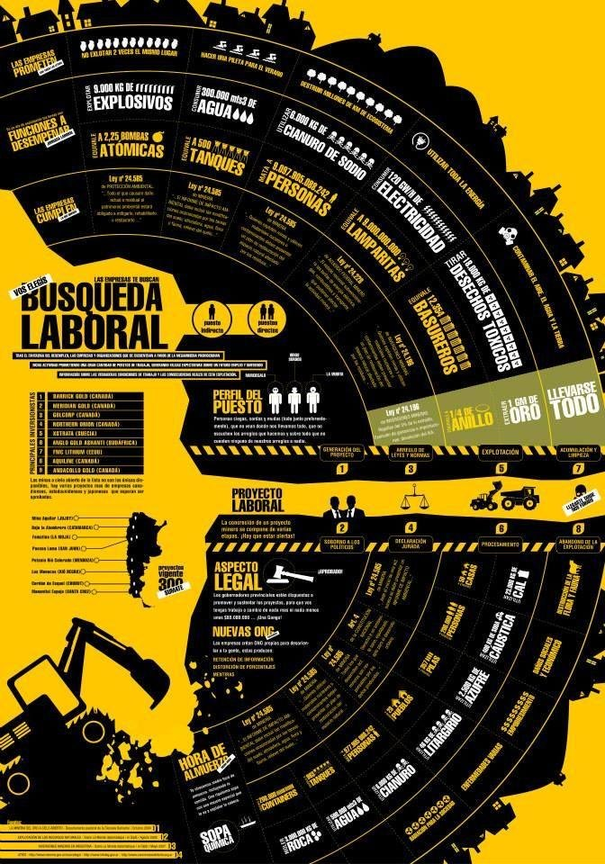

# Búsqueda Laboral

来源为《第三讲－信息图形类型学》第 15 页。原作标题无法可靠识读时使用描述性案名。图像为课件摘录，原作权利属于相应权利人。

## 01 主数据逻辑

[编目型](../../../01-信息图形数据逻辑/03-编目型信息图形概念定义.md)。按主体条目、属性或类别比较。本图可识读记录以「记录对象」及其关系拆解。

## 02 表现标签

[混合型信息图形](../README.md)。统计图、符号和说明合作承载内容。

## 特性、视觉编码与叙事

黄黑高反差凸显标题和扇形层带，剪影交代行业语境，沿内外环浏览组别。

## 制作方法与流程

1. 拆分就业主题、子类别与指标。
2. 映射到环形层带；将剪影与数值层分开并检查阅读方向。

## 基础数据与信息结构

[下载基础数据集（CSV）](基础数据集.csv)。本表记录可辨认的条目、关系或图形构件。源表未随课件提供，无法可靠识读的数值待核验。每行记录一项观测，每列存一个字段。

| 记录对象 | 可见要素 | 来源页 | 证据类型 |
| --- | --- | --- | --- |
| 求职信息 | 环形分组 | 15 | 结构观察 |
| 类别 | 文字标注 | 15 | 结构观察 |
| 行业情境 | 剪影 | 15 | 结构观察 |
