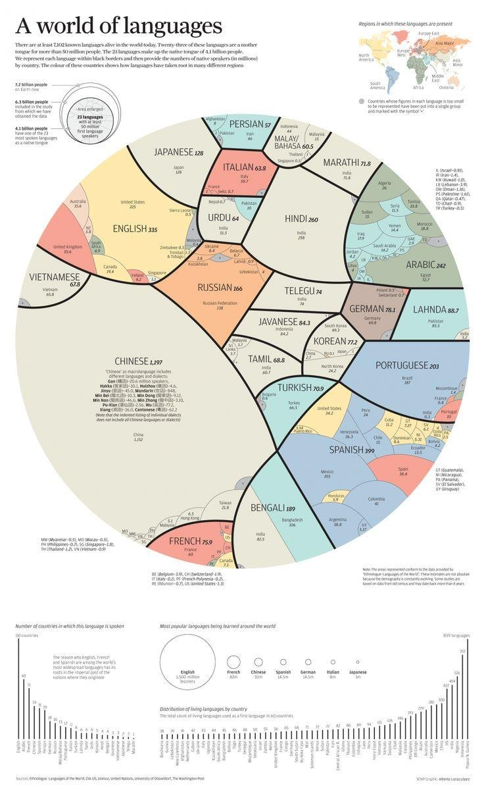

# A World of Languages

来源为《第三讲－信息图形类型学》第 53 页。原作标题无法可靠识读时使用描述性案名。图像为课件摘录，原作权利属于相应权利人。

## 01 主数据逻辑

[编目型](../../../01-信息图形数据逻辑/03-编目型信息图形概念定义.md)。按主体条目、属性或类别比较。本图可识读记录以「记录对象」及其关系拆解。

## 02 表现标签

[混合型信息图形](../README.md)。统计图、符号和说明合作承载内容。

## 特性、视觉编码与叙事

中央分割圆组织语言分组，下方小图支持从类别辨认转向数量比较。

## 制作方法与流程

1. 整理语言、地区及统计口径。
2. 核对互斥关系。
3. 再构造分区圆和独立排序图。

## 基础数据与信息结构

[下载基础数据集（CSV）](基础数据集.csv)。本表记录可辨认的条目、关系或图形构件。源表未随课件提供，无法可靠识读的数值待核验。每行记录一项观测，每列存一个字段。

| 记录对象 | 图面要素 | 来源页 | 证据类型 |
| --- | --- | --- | --- |
| 语言类别 | 多边形 | 53 | 结构观察 |
| 类别补充 | 色彩 | 53 | 结构观察 |
| 指标排序 | 下方条形图 | 53 | 结构观察 |
