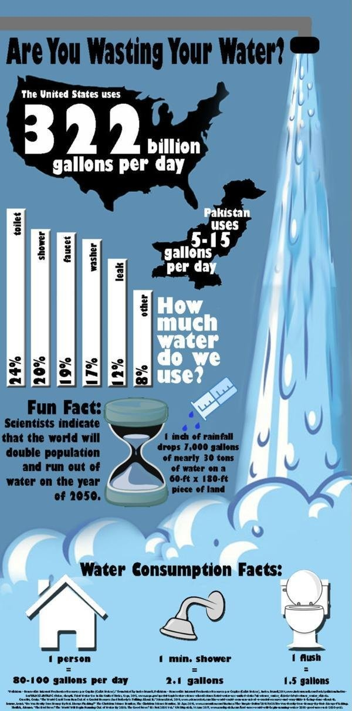

# Are You Wasting Your Water

来源为《第三讲－信息图形类型学》第 56 页。第 56 页左幅，数值按课件转录。

## 01 主数据逻辑

[编目型](../../../01-信息图形数据逻辑/03-编目型信息图形概念定义.md)。按主体条目、属性或类别比较。本图可识读记录以「指标」及其关系拆解。

## 02 表现标签

[混合型信息图形](../README.md)。统计图、符号和说明合作承载内容。

## 特性、视觉编码与叙事

大数字作为入口，水滴、条形和器具图标提供不同场景的用水参照。

## 制作方法与流程

1. 先核对各场景时间和体积单位。
2. 分别绘制比较条与器具图标。
3. 最后加入总量和标题。

## 基础数据与信息结构

[下载基础数据集（CSV）](基础数据集.csv)。本表记录图面可辨认的数值、时间或索引，空白表示未可靠辨认。每行记录一项观测，每列存一个字段。

| 指标 | 数值 | 单位 | 来源页 | 证据类型 |
| --- | --- | --- | --- | --- |
| 美国图示日用水 | 322 | 十亿加仑每天 | 56 | 图面转录 |
| 马桶用水占比 | 24 | % | 56 | 图面转录 |
| 淋浴用水占比 | 20 | % | 56 | 图面转录 |
| 水龙头用水占比 | 19 | % | 56 | 图面转录 |
| 洗衣机用水占比 | 17 | % | 56 | 图面转录 |
| 漏水占比 | 12 | % | 56 | 图面转录 |
| 其他用水占比 | 8 | % | 56 | 图面转录 |
| 一分钟淋浴用水 | 2.1 | 加仑 | 56 | 图面转录 |
| 每次冲厕用水 | 1.5 | 加仑 | 56 | 图面转录 |
