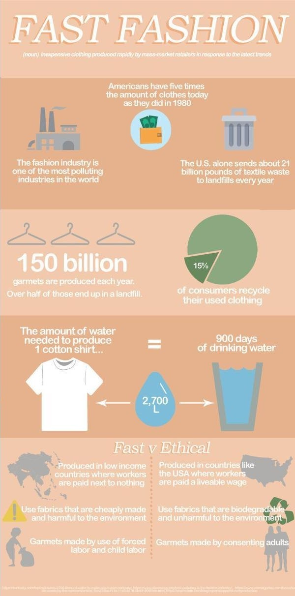

# Fast Fashion

来源为《第三讲－信息图形类型学》第 56 页。第 56 页右幅，统计年份与来源待核验。

## 01 主数据逻辑

[编目型](../../../01-信息图形数据逻辑/03-编目型信息图形概念定义.md)。按主体条目、属性或类别比较。本图可识读记录以「指标」及其关系拆解。

## 02 表现标签

[混合型信息图形](../README.md)。统计图、符号和说明合作承载内容。

## 特性、视觉编码与叙事

暖色模块从总量引入，用服装与水滴图标组织论据，比例图补充构成。

## 制作方法与流程

1. 按供应链环节整理数据和单位。
2. 先绘数量比较。
3. 再按阅读层级安排大数字与符号。

## 基础数据与信息结构

[下载基础数据集（CSV）](基础数据集.csv)。本表记录图面可辨认的数值、时间或索引，空白表示未可靠辨认。每行记录一项观测，每列存一个字段。

| 指标 | 数值 | 单位 | 来源页 | 证据类型 |
| --- | --- | --- | --- | --- |
| 年服装产量 | 1500 | 亿件 | 56 | 图面转录 |
| 消费者回收旧衣比例 | 15 | % | 56 | 图面转录 |
| 生产一件棉衬衣所需用水 | 2700 | 升 | 56 | 图面转录 |
| 图示等值饮用水时长 | 900 | 天 | 56 | 图面转录 |
| 美国年填埋纺织废弃物 | 210 | 亿磅 | 56 | 图面转录 |
