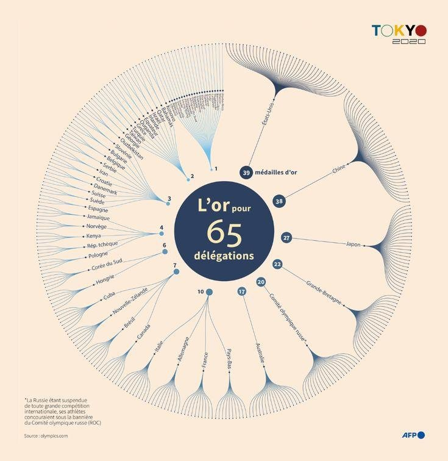

# 东京奥运金牌代表团图

来源为《第三讲－信息图形类型学》第 71 页。原作标题无法可靠识读时使用描述性案名。图像为课件摘录，原作权利属于相应权利人。

## 01 主数据逻辑

[编目型](../../../01-信息图形数据逻辑/03-编目型信息图形概念定义.md)。按主体条目、属性或类别比较。本图可识读记录以「记录对象」及其关系拆解。

## 02 表现标签

[混合型信息图形](../README.md)。统计图、符号和说明合作承载内容。

## 特性、视觉编码与叙事

周向小条承载代表团记录，中心数字概括规模，局部颜色和标注引导识别。

## 制作方法与流程

1. 整理代表团与奖牌类别、计数。
2. 明确径向长度和形态规则。
3. 再按统计口径核对中心合计。

## 基础数据与信息结构

[下载基础数据集（CSV）](基础数据集.csv)。本表记录图面可辨认的数值、时间或索引，空白表示未可靠辨认。每行记录一项观测，每列存一个字段。

| 记录对象 | 图面要素 | 数值 | 来源页 | 证据类型 |
| --- | --- | --- | --- | --- |
| 金牌代表团 | 中心摘要 | 65 | 71 | 图面转录 |
| 代表团记录 | 放射条目 |  | 71 | 图面转录 |
| 分组信息 | 近中心色块 |  | 71 | 图面转录 |
