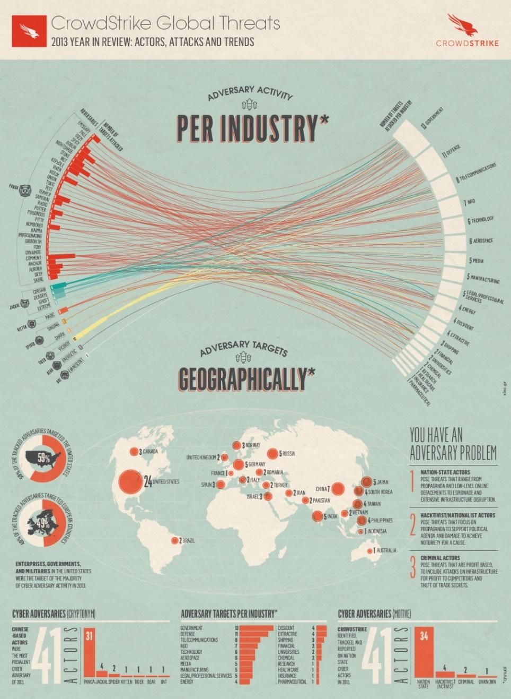

# CrowdStrike全球威胁

来源为用户提供的《第三讲－信息图形类型学》第 36 页。图片提取自课件，图中署名随图保留。

## 案例分析

以行业类别和地理位置组织威胁活动，主数据逻辑为编目型，地理分布为辅助。上部用弧间连线呈现类别关联，中部地图以圆点提供地理定位，下部横向条形补充频数比较。先看行业关联，再转向地区和排名。仅按图面解释，连线权重和圆面积计算待原始数据核验。

[所属标签](../README.md) · [相关数据逻辑](../../../01-信息图形数据逻辑/03-编目型信息图形概念定义.md)
