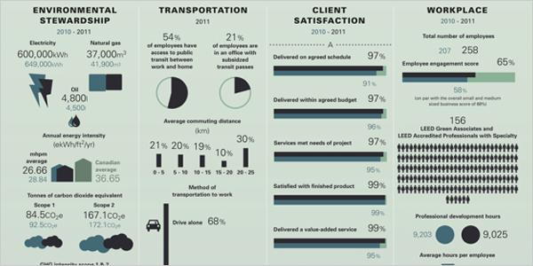

# 可持续发展指标

来源为用户提供的《第三讲－信息图形类型学》第 22 页。图片提取自课件，图中署名随图保留。

## 案例分析

按环境、交通、客户满意度、工作场所四栏组织指标，主数据逻辑为编目型。比例图和条形用于表达份额、横向比较，图标提示指标对象。先扫读栏标题，再在各栏内看数值、年份与单位。配套原始数据未随课件提供。

[所属标签](../README.md) · [相关数据逻辑](../../../01-信息图形数据逻辑/03-编目型信息图形概念定义.md)
