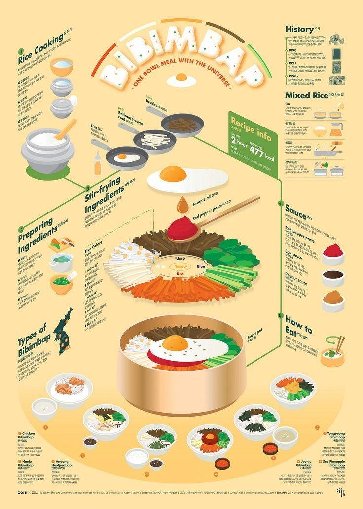

# 一碗拌饭的构成

来源为《第三讲－信息图形类型学》第 25 页。原作标题无法可靠识读时使用描述性案名。图像为课件摘录，原作权利属于相应权利人。

## 01 主数据逻辑

[编目型](../../../01-信息图形数据逻辑/03-编目型信息图形概念定义.md)。按主体条目、属性或类别比较。本图可识读记录以「模块」及其关系拆解。

## 02 表现标签

[示意图型](../README.md)。用构件或动作解释构成与操作。

## 特性、视觉编码与叙事

主视图将分离食材叠入碗中，侧栏文字补充不同部分，底图展示成品变化。

## 制作方法与流程

1. 将食材、构成位置与做法分列表。
2. 以成品为锚生成分层视图。
3. 再挂说明与变体。

## 基础数据与信息结构

[下载基础数据集（CSV）](基础数据集.csv)。本表记录可辨认的条目、关系或图形构件。源表未随课件提供，无法可靠识读的数值待核验。每行记录一项观测，每列存一个字段。

| 模块 | 图面要素 | 来源页 | 证据类型 |
| --- | --- | --- | --- |
| 食材 | 原料插图 | 25 | 结构观察 |
| 组装 | 分层示意 | 25 | 结构观察 |
| 成品 | 碗装视图 | 25 | 结构观察 |
| 变化 | 底部小图 | 25 | 结构观察 |
