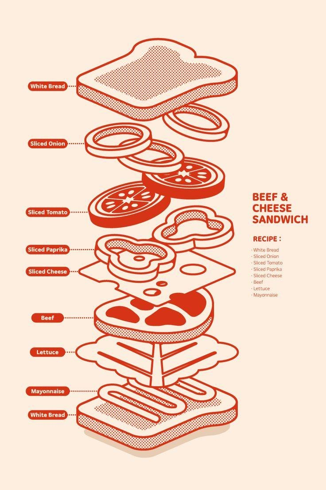

# 牛肉芝士三明治拆解

来源为《第三讲－信息图形类型学》第 25 页。原作标题无法可靠识读时使用描述性案名。图像为课件摘录，原作权利属于相应权利人。

## 01 主数据逻辑

[层级型](../../../01-信息图形数据逻辑/02-层级型信息图形概念定义.md)。按父子、部分与整体或从属层次检索。本图可识读记录以「部件」及其关系拆解。

## 02 表现标签

[示意图型](../README.md)。用构件或动作解释构成与操作。

## 特性、视觉编码与叙事

同轴爆炸视图用接续位置展示装配关系，左侧引线逐层标示名称。

## 制作方法与流程

1. 登记夹层顺序和部件名称。
2. 按同一透视绘图。
3. 统一红色轮廓与左侧标签。

## 基础数据与信息结构

[下载基础数据集（CSV）](基础数据集.csv)。本表记录可辨认的条目、关系或图形构件。源表未随课件提供，无法可靠识读的数值待核验。每行记录一项观测，每列存一个字段。

| 部件 | 图面要素 | 来源页 | 证据类型 |
| --- | --- | --- | --- |
| 面包 | 外层 | 25 | 结构观察 |
| 蔬菜 | 夹层 | 25 | 结构观察 |
| 牛肉 | 夹层 | 25 | 结构观察 |
| 芝士 | 夹层 | 25 | 结构观察 |
