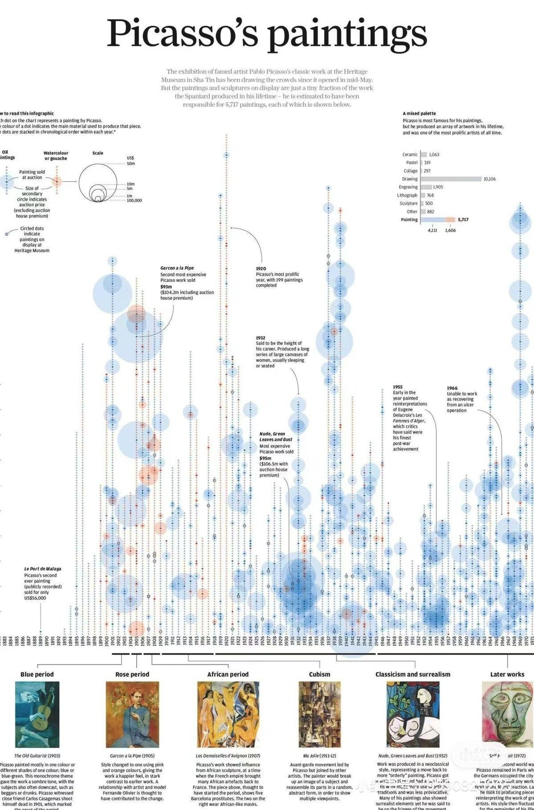

# Picasso绘画创作分布

来源为《第三讲－信息图形类型学》第 11 页。原作标题无法可靠识读时使用描述性案名。图像为课件摘录，原作权利属于相应权利人。

## 01 主数据逻辑

[编年型](../../../01-信息图形数据逻辑/01-编年型信息图形概念定义.md)。顺序、时期或步骤是主索引。本图可识读记录以「记录对象」及其关系拆解。

## 02 表现标签

[编年编目复合型](../README.md)。阶段顺序与类别共同组织图面。

## 特性、视觉编码与叙事

横轴连接创作时期，气泡表示各时段内的作品信息，底部图像为细读示例。

## 制作方法与流程

1. 记录作品和可确认的年代、类别。
2. 分期聚合后配置气泡与图例。
3. 再选择代表画作加入底部。

## 基础数据与信息结构

[下载基础数据集（CSV）](基础数据集.csv)。本表记录可辨认的条目、关系或图形构件。源表未随课件提供，无法可靠识读的数值待核验。每行记录一项观测，每列存一个字段。

| 记录对象 | 可见要素 | 来源页 | 证据类型 |
| --- | --- | --- | --- |
| 创作期 | 横向位置 | 11 | 结构观察 |
| 作品集合 | 气泡 | 11 | 结构观察 |
| 代表作 | 缩略图 | 11 | 结构观察 |
