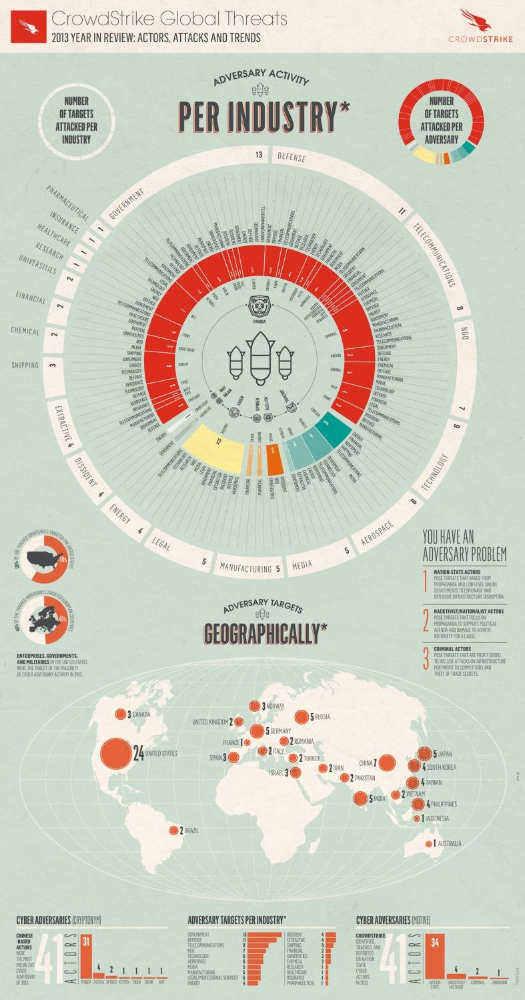

# CrowdStrike行业与地理环形版本

来源为《第三讲－信息图形类型学》第 36 页。行业分类主导中央图，外部环带与阶段信息构成复合表现。

## 01 主数据逻辑

[编目型](../../../01-信息图形数据逻辑/03-编目型信息图形概念定义.md)。按主体条目、属性或类别比较。本图可识读记录以「模块」及其关系拆解。

## 02 表现标签

[编年编目复合型](../README.md)。阶段顺序与类别共同组织图面。

## 特性、视觉编码与叙事

环形视图把行业活动置于共同中心，地图与条形图补充分布和排名。

## 制作方法与流程

1. 先将行业、活动时期、地点和指标拆成可连接的表；建立分环尺度。
2. 再补地图和底部条图。

## 基础数据与信息结构

[下载基础数据集（CSV）](基础数据集.csv)。本表记录可辨认的条目、关系或图形构件。源表未随课件提供，无法可靠识读的数值待核验。每行记录一项观测，每列存一个字段。

| 模块 | 图面要素 | 来源页 | 证据类型 |
| --- | --- | --- | --- |
| 行业活动 | 同心径向图 | 36 | 结构观察 |
| 地理目标 | 点状地图 | 36 | 结构观察 |
| 比较 | 底部条形图 | 36 | 结构观察 |

[对照关联图件](../../混合型信息图形/CrowdStrike全球威胁/案例分析.md)
