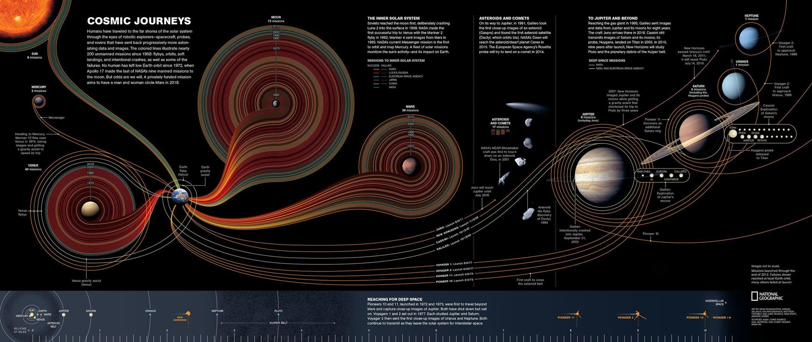

# Cosmic Journeys

来源为《第三讲－信息图形类型学》第 37 页。原作标题无法可靠识读时使用描述性案名。图像为课件摘录，原作权利属于相应权利人。

## 01 主数据逻辑

[编年型](../../../01-信息图形数据逻辑/01-编年型信息图形概念定义.md)。顺序、时期或步骤是主索引。本图可识读记录以「记录对象」及其关系拆解。

## 02 表现标签

[编年编目复合型](../README.md)。阶段顺序与类别共同组织图面。

## 特性、视觉编码与叙事

行星周围的曲线路径聚拢为轨迹组，下部时间参照与文案补充任务背景。

## 制作方法与流程

1. 为任务记录时间、目的天体和轨迹键。
2. 分别生成时间和天体视图。
3. 核对轨迹标签及比例说明。

## 基础数据与信息结构

[下载基础数据集（CSV）](基础数据集.csv)。本表记录可辨认的条目、关系或图形构件。源表未随课件提供，无法可靠识读的数值待核验。每行记录一项观测，每列存一个字段。

| 记录对象 | 图面要素 | 来源页 | 证据类型 |
| --- | --- | --- | --- |
| 任务 | 轨迹 | 37 | 结构观察 |
| 天体 | 行星图像 | 37 | 结构观察 |
| 时间 | 下方参照轴 | 37 | 结构观察 |
