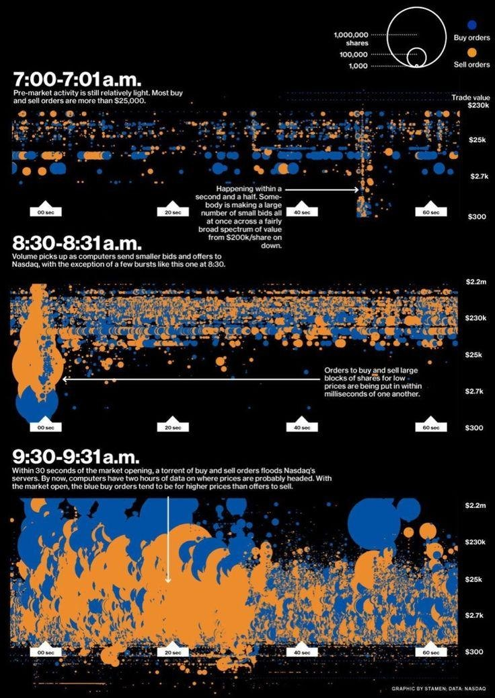

# 早晨三个时窗活动图

来源为《第三讲－信息图形类型学》第 50 页。原作标题无法可靠识读时使用描述性案名。图像为课件摘录，原作权利属于相应权利人。

## 01 主数据逻辑

[编年型](../../../01-信息图形数据逻辑/01-编年型信息图形概念定义.md)。顺序、时期或步骤是主索引。本图可识读记录以「时窗起点」及其关系拆解。

## 02 表现标签

[编年编目复合型](../README.md)。阶段顺序与类别共同组织图面。

## 特性、视觉编码与叙事

相同版式切换三段早晨时间，蓝橙色区分两类标记，位置和尺寸支持时段对比。

## 制作方法与流程

1. 按相同时间窗切片。
2. 把类别和计数拆表。
3. 统一三行尺度。
4. 标注时间边界。

## 基础数据与信息结构

[下载基础数据集（CSV）](基础数据集.csv)。本表记录图面可辨认的数值、时间或索引，空白表示未可靠辨认。每行记录一项观测，每列存一个字段。

| 时窗起点 | 时窗终点 | 来源页 | 证据类型 |
| --- | --- | --- | --- |
| 07:00 | 07:01 | 50 | 图面转录 |
| 08:30 | 08:31 | 50 | 图面转录 |
| 09:30 | 09:31 | 50 | 图面转录 |
