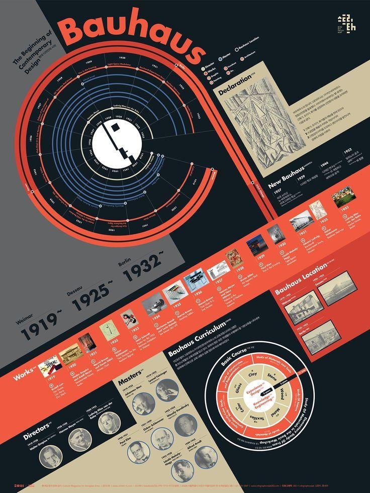

# Bauhaus时期与作品

来源为《第三讲－信息图形类型学》第 52 页。原作标题无法可靠识读时使用描述性案名。图像为课件摘录，原作权利属于相应权利人。

## 01 主数据逻辑

[编年型](../../../01-信息图形数据逻辑/01-编年型信息图形概念定义.md)。顺序、时期或步骤是主索引。本图可识读记录以「时间锚点」及其关系拆解。

## 02 表现标签

[编年编目复合型](../README.md)。阶段顺序与类别共同组织图面。

## 特性、视觉编码与叙事

斜向年带串起年代，圆形板块与作品卡给读者提供分区细读。

## 制作方法与流程

1. 先以日期联结作品和阶段。
2. 完成主时间轴后安排圆形细节和作品缩图。

## 基础数据与信息结构

[下载基础数据集（CSV）](基础数据集.csv)。本表记录可辨认的条目、关系或图形构件。源表未随课件提供，无法可靠识读的数值待核验。每行记录一项观测，每列存一个字段。

| 时间锚点 | 图面角色 | 来源页 | 证据类型 |
| --- | --- | --- | --- |
| 1919 | 主年带 | 52 | 结构观察 |
| 1925 | 主年带 | 52 | 结构观察 |
| 1932 | 主年带 | 52 | 结构观察 |
